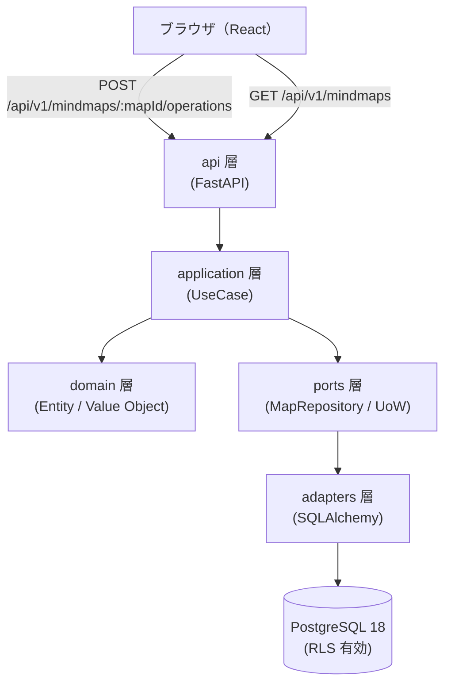
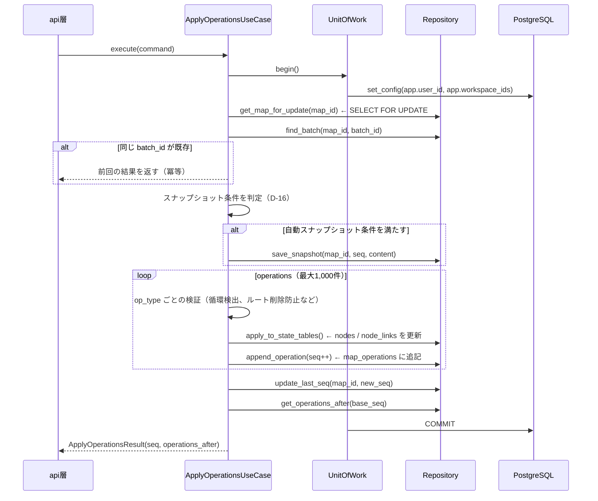
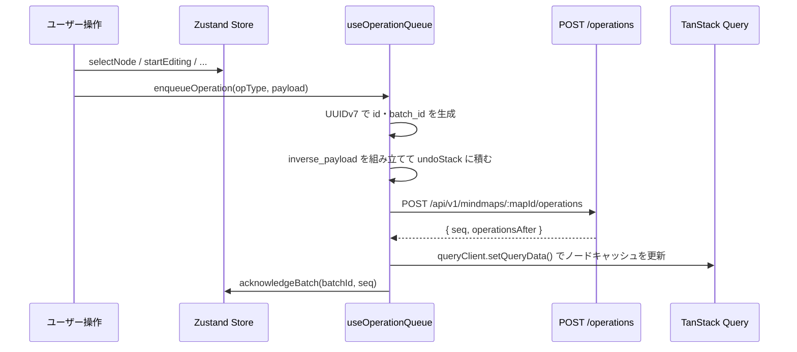
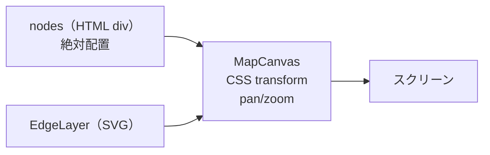
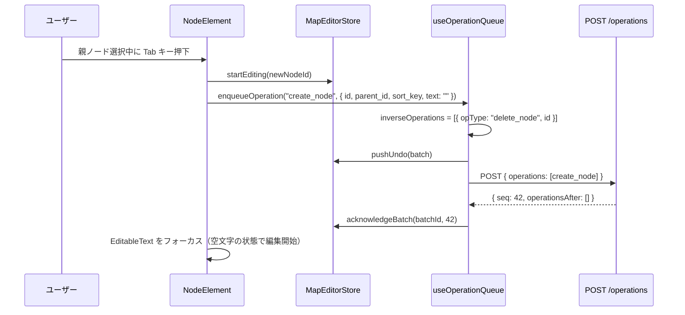
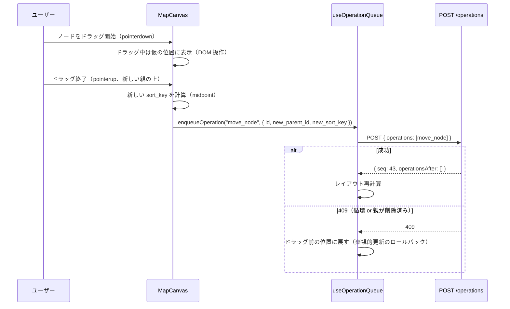

# 設計文書：マインドマップの編集（map）

## Overview

本設計はマインドマップの編集機能（MM-01〜MM-07、P1）を対象とする。マップの作成・一覧・削除（MM-01）、ノードの追加・編集・削除（MM-02）、ノードの移動（MM-03）、折りたたみ（MM-04）、自動レイアウト・ズーム・パン（MM-05）、キーボード操作（MM-06）、Undo/Redo（MM-07）を含む。

変更履歴の保持（D-02）、共同編集への備え（A-02、D-13）、行レベルセキュリティ（D-14）はP1から有効にする。

---

## Architecture



---

## Components and Interfaces

### バックエンドの層の構成（ADR 0035）

| 層 | 主なクラス・モジュール | 責務 |
|---|---|---|
| `domain` | `Mindmap`, `Node`, `NodeLink`, `MapOperation`, `SortKey` | エンティティ、値オブジェクト、ドメインルール（循環検出など） |
| `ports` | `MapRepository`, `NodeRepository`, `MapOperationRepository`, `MapSnapshotRepository`, `UnitOfWork` | DBアクセスの抽象 |
| `application` | `CreateMapUseCase`, `ListMapsUseCase`, `GetMapUseCase`, `UpdateMapUseCase`, `DeleteMapUseCase`, `ApplyOperationsUseCase`, `GetOperationsAfterUseCase` | ユースケース。認可・トランザクション境界 |
| `adapters` | `PgMapRepository`, `PgNodeRepository`, `PgMapOperationRepository`, `PgMapSnapshotRepository`, `PgUnitOfWork` | SQLAlchemy による実装 |
| `api` | `maps_router`, `MapResponse`, `MapCreateRequest`, `MapUpdateRequest`, `OperationBatchRequest`, `OperationBatchResponse` | FastAPI のルーター・Pydantic スキーマ |

#### 主なユースケース一覧

| ユースケース | 入力コマンド | 出力 |
|---|---|---|
| `CreateMapUseCase` | `CreateMapCommand(actor, title)` | `CreateMapResult(map_id)` |
| `ListMapsUseCase` | `ListMapsCommand(actor, cursor, limit)` | `ListMapsResult(items, next_cursor)` |
| `GetMapUseCase` | `GetMapCommand(actor, map_id)` | `GetMapResult(mindmap, nodes, node_links)` |
| `UpdateMapUseCase` | `UpdateMapCommand(actor, map_id, title?, deleted_at?)` | `UpdateMapResult(map)` |
| `DeleteMapUseCase` | `DeleteMapCommand(actor, map_id)` | `DeleteMapResult()` |
| `ApplyOperationsUseCase` | `ApplyOperationsCommand(actor, map_id, base_seq, operations, batch_id, client_id, origin, intent?)` | `ApplyOperationsResult(seq, operations_after)` |
| `GetOperationsAfterUseCase` | `GetOperationsAfterCommand(actor, map_id, after_seq)` | `GetOperationsAfterResult(operations)` |

### ApplyOperationsUseCase の処理フロー



**スナップショット自動保存条件（D-16）**：
- 前回の操作から30分以上経過している、または
- 前回のスナップショットから200操作以上経過している

### 操作ログの適用

op_type と payload / inverse_payload の対応（詳細は `docs/requirements/05a-tables.md` の「操作ログの仕様」節に従う）：

| op_type | payload の主な内容 | inverse_payload | 409 拒否条件 |
|---|---|---|---|
| `create_node` | 新ノードの全項目（id, parent_id, sort_key, text, note, style, collapsed, is_floating, position_x, position_y） | 作成したノードの id | 親が存在しない・削除済み・別マップ。同 id の未削除ノードあり |
| `delete_node` | 削除するノードの id | 削除した枝の全ノード・つながり線の削除前の全項目 | ルートノードを削除しようとした |
| `move_node` | id, new_parent_id, new_sort_key（必ず同時に送る） | 元の parent_id, sort_key | 循環ができる移動。親が削除済み。ルートを移動しようとした |
| `update_node` | id, 変更した項目と新しい値 | 同じ項目の元の値 | ノードが存在しない・削除済み |
| `update_map` | 変更した項目（title, layout） | 同じ項目の元の値 | ― |
| `create_link` | つながり線の全項目 | 作成したつながり線の id | ※ P1 スコープ外 |
| `delete_link` | id | 削除前の全項目 | ※ P1 スコープ外 |
| `update_link` | id, 変更した項目と新しい値 | 同じ項目の元の値 | ※ P1 スコープ外 |

**バッチ適用のルール**：
- 1 つのバッチはすべて適用するか、1 件も適用しないかのどちらか（トランザクション境界と一致）
- 1 バッチの上限は 1,000 操作
- 同じ `batch_id` の再送は適用せず、前回の結果を返す（冪等性）

**項目単位の後勝ち（D-13）**：`update_node` / `update_link` / `move_node` は項目単位で後から届いた値を残す。同じ項目への変更は `seq` の大きいほうが残る。

### 兄弟の並び順（sort_key：分数インデックス）

`sort_key` は COLLATE "C" の文字列比較で順序を表す分数インデックスを使う（D-01）。

**採番ルール**：
- **末尾に追加**：既存の最大 `sort_key` より辞書順で大きい文字列を生成する。
- **兄弟間に挿入**：前の `sort_key` と後の `sort_key` の midpoint を計算する。
- **先頭に挿入**：既存の最小 `sort_key` より辞書順で小さい文字列を生成する。

**未決**：sort_key の midpoint 計算を繰り返した際の文字列長増大（衝突リスク）と、再割り当て（rebalance）の発動条件・タイミング。

### RLS とワークスペースの文脈（D-19）

`PgUnitOfWork.begin()` がトランザクション開始直後に以下を実行する：

```sql
-- set_config は is_local = true で現在のトランザクション中のみ有効
SELECT set_config('app.user_id', :user_id, true);
SELECT set_config('app.workspace_ids', :workspace_ids_array, true);
```

RLS ポリシーの形（全 workspace 所属テーブルに適用）：

```sql
-- USING (読み取り条件)
workspace_id = ANY(app_current_workspace_ids())
-- WITH CHECK (書き込み条件)
workspace_id = ANY(app_current_workspace_ids())
```

`app_current_workspace_ids()` は `current_setting('app.workspace_ids', true)` を UUID 配列にキャストするヘルパー関数（ADR 0035）。

### API エンドポイント

ワークスペースはパスに含めない（D-19）。

| メソッド | パス | 説明 | 成功時 |
|---|---|---|---|
| `GET` | `/api/v1/mindmaps` | マップ一覧（カーソルページング） | 200 |
| `POST` | `/api/v1/mindmaps` | マップ作成（冪等：同 id で再送したら既存を返す） | 201 |
| `GET` | `/api/v1/mindmaps/{mapId}` | マップ取得（全ノード・つながり線含む） | 200 |
| `PATCH` | `/api/v1/mindmaps/{mapId}` | マップ更新（title, deleted_at） | 200 |
| `POST` | `/api/v1/mindmaps/{mapId}/operations` | 操作のまとまりを適用 | 200 |
| `GET` | `/api/v1/mindmaps/{mapId}/operations` | `?after={seq}` で指定 seq 以降の操作を取得 | 200 |

**`POST /api/v1/mindmaps/{mapId}/operations` のリクエスト／レスポンス**：

```typescript
// Request
{
  baseSeq: number,       // クライアントが認識している最新 seq
  batchId: string,       // UUIDv7（クライアント生成）
  clientId: string,      // タブを識別する ID
  origin: "user" | "ai" | "import" | "restore",
  intent?: string,       // "undo", "redo", "paste" など
  operations: Array<{
    id: string,          // UUIDv7（クライアント生成）
    opType: string,
    opVersion: number,
    payload: object
  }>
}

// Response
{
  seq: number,                 // このバッチに採番された最後の seq
  operationsAfter: Array<...>  // baseSeq より後の他の操作（追いつき用）
}
```

**ETag**：`GET /api/v1/mindmaps/{mapId}` のレスポンスに `ETag: "{last_seq}"` を付ける。

## Error Handling

### エラー一覧

| 状況 | ステータス | type |
|---|---|---|
| 循環する移動 | 409 | `/problems/circular-reference` |
| ルートノードの削除・移動 | 409 | `/problems/root-node-immutable` |
| 親ノードが存在しない・削除済み | 409 | `/problems/invalid-parent` |
| 同 id の未削除ノードあり（create_node） | 409 | `/problems/duplicate-node-id` |
| 存在しない・削除済みノードへの update/move | 409 | `/problems/node-not-found` |
| 1,000 操作超過 | 422 | `/problems/batch-too-large` |
| 未認証 | 401 | — |
| ワークスペース非所属 | 403 | — |
| マップが見つからない（または見る権限がない） | 404 | — |

---

## Data Models

### `features/map` のファイル構成

```
src/features/map/
├── components/
│   ├── MapList.tsx           # マップ一覧（MM-01）
│   ├── MapEditor.tsx         # エディタ全体レイアウト（キャンバス + ツールバー）
│   ├── MapCanvas.tsx         # pan/zoom コンテナ（CSS transform）
│   ├── NodeElement.tsx       # 個々のノード（HTML div、絶対配置）
│   ├── EditableText.tsx      # インライン編集テキスト（IME 対応）
│   ├── CollapseToggle.tsx    # 折りたたみ丸ボタン
│   └── EdgeLayer.tsx         # つながり線 SVG レイヤー
├── hooks/
│   ├── useMapEditor.ts       # エディタ全体の初期化・データ取得
│   ├── useOperationQueue.ts  # 操作のキューイングと POST
│   ├── useUndoStack.ts       # Undo/Redo スタック管理
│   ├── useAutoLayout.ts      # d3-hierarchy によるレイアウト計算
│   ├── useKeyboardShortcuts.ts # キーボード操作（MM-06）
│   ├── useImeComposition.ts  # IME compositionstart/end フラグ
│   ├── usePanZoom.ts         # pan/zoom のポインターイベント処理
│   └── useCatchUp.ts         # 追いつき API ポーリング
├── store/
│   └── mapEditorStore.ts     # Zustand ストア
└── api/
    └── mapApi.ts             # TanStack Query のクエリ・ミューテーション定義
```

### Zustand ストア（MapEditorStore）

```typescript
interface MapEditorState {
  // 選択・編集状態
  selectedNodeId: string | null
  editingNodeId: string | null
  isComposing: boolean           // IME 変換中フラグ

  // Undo/Redo（D-15）
  undoStack: BatchOperation[]
  redoStack: BatchOperation[]

  // pan/zoom（MM-05）
  viewTransform: {
    scale: number
    translateX: number
    translateY: number
  }

  // 操作キュー
  pendingOperations: PendingBatch[]
  lastAcknowledgedSeq: number

  // アクション
  selectNode(nodeId: string | null): void
  startEditing(nodeId: string): void
  stopEditing(): void
  setComposing(value: boolean): void
  pushUndo(batch: BatchOperation): void
  pushRedo(batch: BatchOperation): void
  clearRedo(): void
  setViewTransform(t: ViewTransform): void
  enqueueBatch(batch: PendingBatch): void
  acknowledgeBatch(batchId: string, seq: number): void
}
```

```typescript
// 型定義
interface BatchOperation {
  batchId: string
  operations: OperationSpec[]
  inverseOperations: OperationSpec[]  // Undo 用
  intent?: string
}

interface PendingBatch {
  batchId: string
  baseSeq: number
  clientId: string
  origin: OperationOrigin
  intent?: string
  operations: OperationSpec[]
}
```

### 操作のクライアント側フロー



**Undo の手順（D-15）**：
1. `undoStack` からバッチを取り出す
2. `intent = "undo"` として `inverseOperations` を POST する
3. 成功後、元のバッチを `redoStack` に積む

**Redo の手順**：
1. `redoStack` からバッチを取り出す
2. `intent = "redo"` として元の `operations` を POST する
3. 成功後、バッチを `undoStack` に戻す

### 追いつき API（`useCatchUp`）

P1 ではポーリングで実装する。画面復帰時・一定間隔（未決：間隔）で `GET /api/v1/mindmaps/{mapId}/operations?after={lastAcknowledgedSeq}` を呼び出し、受け取った操作を TanStack Query のキャッシュに反映する。

P2 以降で SSE への移行を検討する（C-10）。

**未決**：ポーリング間隔（例：30 秒）。

### 描画（ADR 0012）



| 要素 | 実装方式 |
|---|---|
| ノード | `<div>` の絶対配置。`left` / `top` を CSS で設定 |
| つながり線 | 1 枚の `<svg>` を重ね、`<path>` で描画 |
| pan/zoom | CSS `transform: translate() scale()` |
| レイアウト計算 | `d3-hierarchy`（左右展開。新規追加・移動・折りたたみのたびに再計算） |
| 文字幅測定 | `<canvas>` の `measureText()`（レイアウト計算の前に実行） |
| アニメーション | CSS `transition: left, top`（ノード移動時） |

**d3-hierarchy の左右展開ルール（MM-05）**：第1階層ノードは、左右の枝の数が均等になるように交互に割り振る。同数のときは右優先。

### 日本語 IME の扱い（MM-02）

`EditableText` コンポーネントで `compositionstart` / `compositionend` イベントを監視し、`isComposing` フラグを Zustand ストアに保持する。

| イベント | 処理 |
|---|---|
| `compositionstart` | `isComposing = true` |
| `compositionend` | `isComposing = false` |
| `keydown` で `Enter` かつ `isComposing = true` | 変換確定として扱う。ノードを増やさない |
| `keydown` で `Enter` かつ `isComposing = false` | 下に兄弟ノードを追加（MM-02）|

`editingNodeId` が設定されている間は、`useKeyboardShortcuts` のグローバルショートカット（矢印キー、Delete、Space、Ctrl+Z 等）を無効化する。ただし `Enter`・`Shift+Enter`・`Tab`・`Esc` は `EditableText` 側で処理する。

### ズーム・パンの保存（MM-05）

**未決**：`viewTransform`（scale, translateX, translateY）の保存先をサーバー（`user_settings` のような別テーブル）にするか `localStorage` にするか。

P1 では実装コストが低い `localStorage` を採用し、キーを `thinkronos:map:{mapId}:viewTransform` とする方向で検討する。サーバー保存は複数端末での同期が必要と判断した場合に後から追加できる。

### 折りたたみ（MM-04）

- ユーザーが `CollapseToggle` を押す、または `Space` キーを押す
- `update_node` 操作（`{ id, collapsed: !current_collapsed }` を payload）をキューに積む
- サーバーに POST → `nodes.collapsed` として永続化
- TanStack Query のキャッシュを更新後、`useAutoLayout` がレイアウトを再計算

---

## Undo / Redo の設計（MM-07、D-15）

### スタックの構造

```typescript
// undoStack[undoStack.length - 1] が直近の操作
undoStack: BatchOperation[]
redoStack: BatchOperation[]

// ページ再読み込みでスタックが消える（D-15）
// → Zustand ストアはメモリのみ（永続化しない）
```

### スタックの操作ルール

| 操作 | undoStack | redoStack |
|---|---|---|
| ユーザーが操作を行った | push | clear（新しい操作でやり直し履歴を消す） |
| Undo 成功 | pop | push（逆操作バッチ） |
| Redo 成功 | push（元の操作バッチ） | pop |
| 追いつき API で他の操作が来た | 変更しない | 変更しない（D-15） |

### `inverse_payload` の組み立て

クライアントは操作を POST する前に、成功後に使う `inverseOperations` を組み立ててスタックに積む。ただし `delete_node` の `inverse_payload`（枝全体の内容）はサーバーからレスポンスで受け取る必要がある。

**未決**：`delete_node` の `inverse_payload` をサーバーのレスポンスに含めるか、`GET /api/v1/mindmaps/{mapId}/operations?after={seq-1}&limit=1` で取得するか。

---

## シーケンス図：主要フロー

### ノードを追加する（MM-02）



### ノードをドラッグして移動する（MM-03）



---

## Correctness Properties

以下の特性を `tests/unit/` および `tests/integration/` で確認する。

### Property 1: 操作ログの冪等性

同じ `batch_id` を 2 回送っても `nodes` と `map_operations` の状態が変わらない（結合テスト）。

**Validates: Requirements MM-07, D-15**

### Property 2: 循環なし

`move_node` を適用しても、ノードが自分の子孫にならない（単体テスト：domain 層の循環検出）。

**Validates: Requirements MM-03, D-13**

### Property 3: ルート不変

`delete_node` / `move_node` でルートノードに対して必ず 409 を返す（結合テスト）。

**Validates: Requirements MM-02, MM-03**

### Property 4: sort_key 一意性

兄弟の `sort_key` が重複しない（挿入・並べ替え後も）（単体テスト）。

**Validates: Requirements MM-02, MM-03, D-01**

### Property 5: Undo 可逆性

操作 → Undo で元の `nodes` のスナップショットと一致する（同一タブ・割り込みなしの条件下）（結合テスト）。

**Validates: Requirements MM-07, D-15**

### Property 6: スナップショット整合性

スナップショット + それ以降の操作を再適用した結果が現在の `nodes` と一致する（結合テスト）。

**Validates: Requirements D-12, D-16**

### Property 7: 認可

別ワークスペースのマップへの操作は RLS により拒否される（結合テスト：D-14、AU-03）。

**Validates: Requirements AU-03, D-14**

---

## Testing Strategy

### テスト戦略（このフィーチャーの範囲）

### 単体テスト（`backend/tests/unit/`）

- `SortKey` の midpoint 計算ロジック
- domain 層の循環検出アルゴリズム
- `ApplyOperationsUseCase` の各 op_type の検証（ポートをモック）

### 結合テスト（`backend/tests/integration/`）

- Testcontainers + PostgreSQL 18（`thinkronos/postgres:18`）を使用
- `thinkronos_app` ロールで接続し、RLS が有効な状態で確認（ADR 0035、I-01）
- 上記 P-01〜P-07 の特性を確認
- マイグレーション：適用 → 戻す → 再適用

### フロントエンドテスト（`frontend/src/features/map/`）

- `EditableText`：IME フラグのテスト（compositionstart/end → Enter の振る舞い）
- `useUndoStack`：スタックの push/pop ルール
- `useAutoLayout`：d3-hierarchy の出力からノード座標が正しく計算されること
- `MapCanvas`：描画方式が ADR 0012（HTML + SVG + CSS transform）に従っていること

### E2E テスト（`frontend/e2e/`）

- スモーク：ログイン → マップ作成 → ノード追加（I-07、`create-map.spec.ts`）
- キーボード操作：Tab / Enter / Delete / Ctrl+Z が期待通りに動くこと（MM-06、MM-07）

---

## 未決事項

| ID | 内容 | 決める時期 |
|---|---|---|
| U-01 | ズーム・パンの保存先（`localStorage` vs サーバーの別テーブル） | P1 実装前 |
| U-02 | `sort_key` 衝突時の再割り当て（rebalance）の発動条件とタイミング | P1 実装前 |
| U-03 | 1 つのマップに置けるトピック数の上限と、テキストの文字数の上限（NF-02 の前提は 500 トピック） | P1 実装前 |
| U-04 | 追いつき API のポーリング間隔（P1 はポーリング。P2 以降で SSE を検討、C-10） | P1 実装前 |
| U-05 | 同じマップを 2 つのタブで同時に編集したときの表示の整合（後勝ちだが追いつき API の頻度で視覚的なずれが生じる） | P1 実装前 |
| U-06 | `delete_node` の `inverse_payload` の取得方法（サーバーのレスポンスに含める vs 追いつき API で取得） | P1 実装前 |

---

## 依存ライブラリ

| ライブラリ | 用途 | ライセンス |
|---|---|---|
| `d3-hierarchy` | ツリーレイアウト計算 | ISC |
| `d3-zoom` | ズーム補助（pan/zoom の数値計算のみ使用する場合） | ISC |
| `@tanstack/react-query` | サーバーデータのキャッシュと再取得 | MIT |
| `zustand` | エディタ内状態管理 | MIT |
| `openapi-fetch` | 型安全な API クライアント | MIT |
