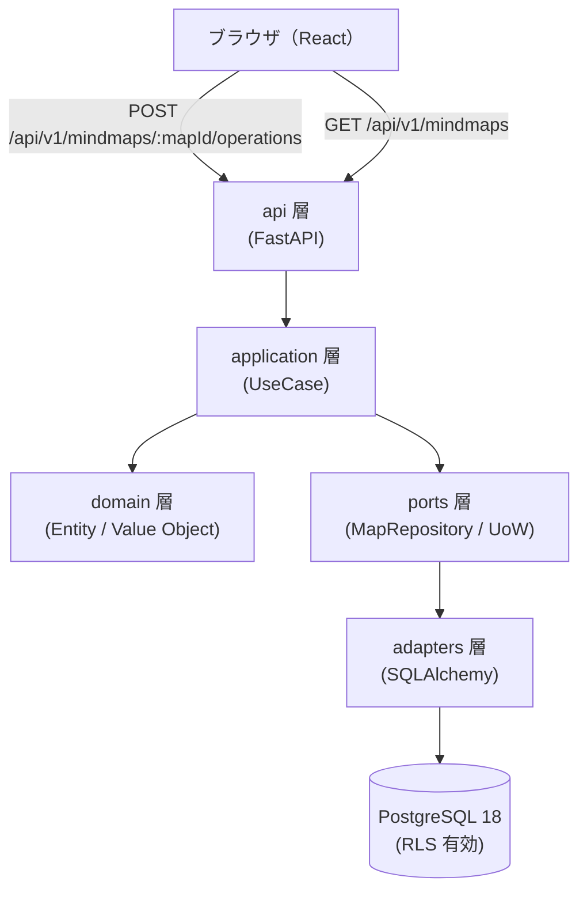
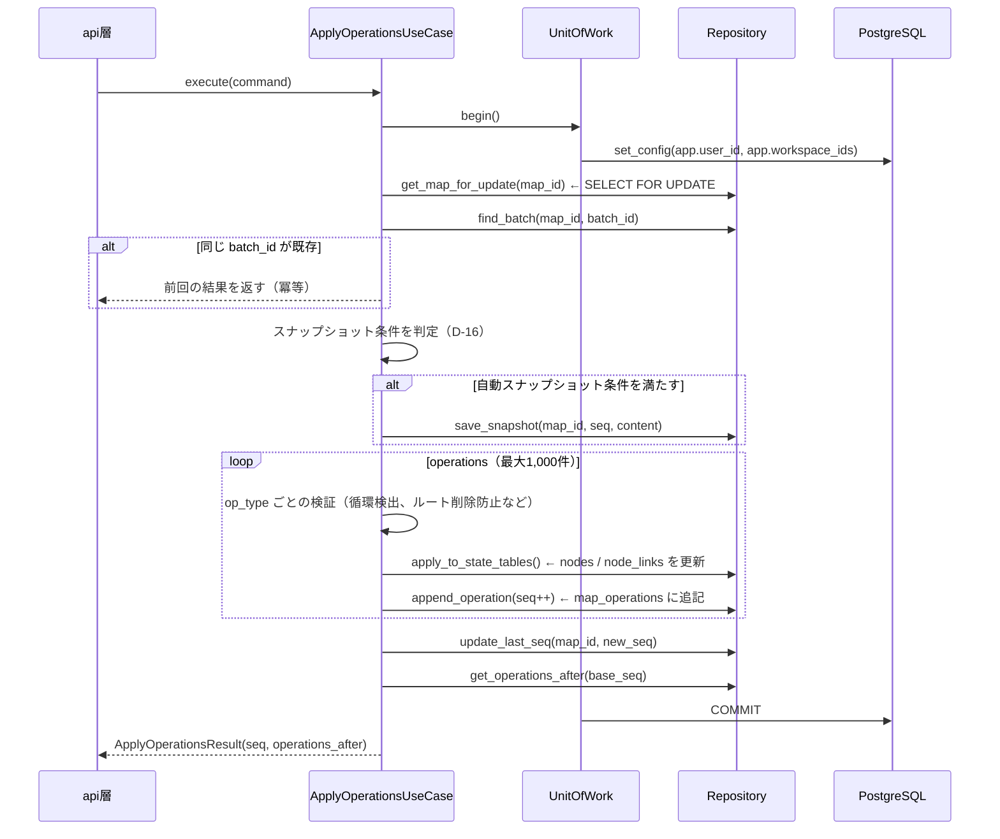
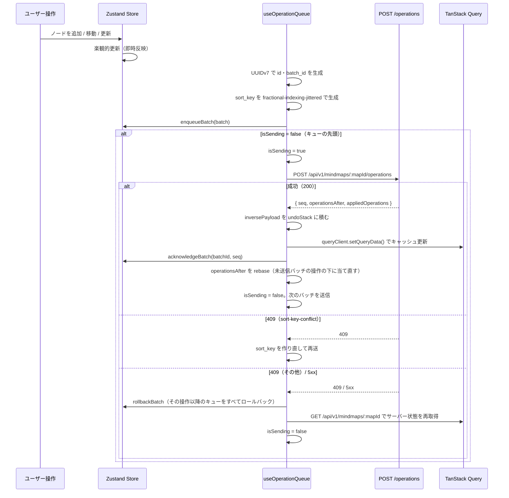
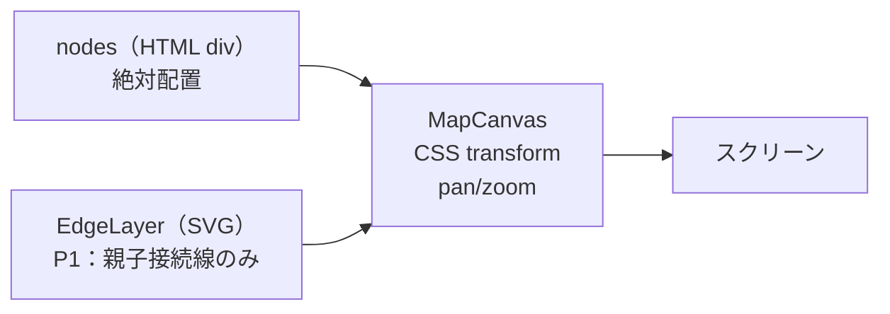
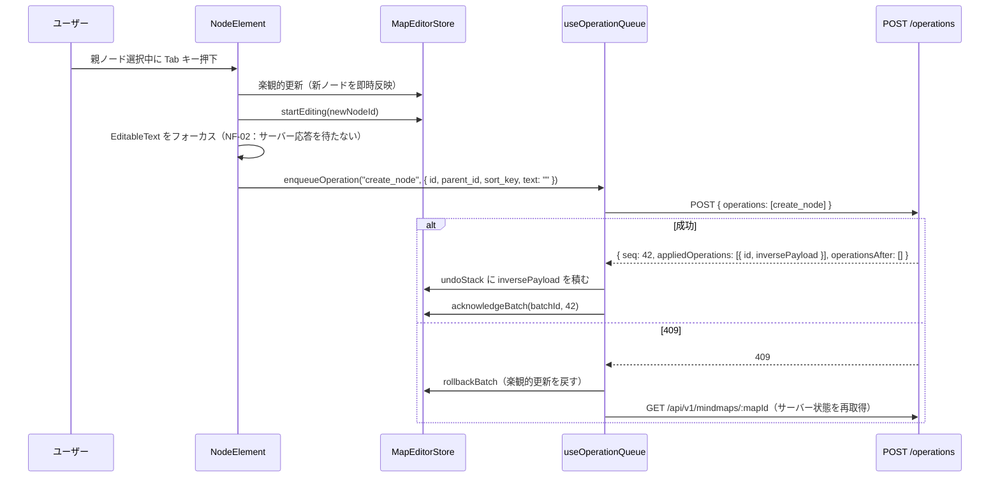
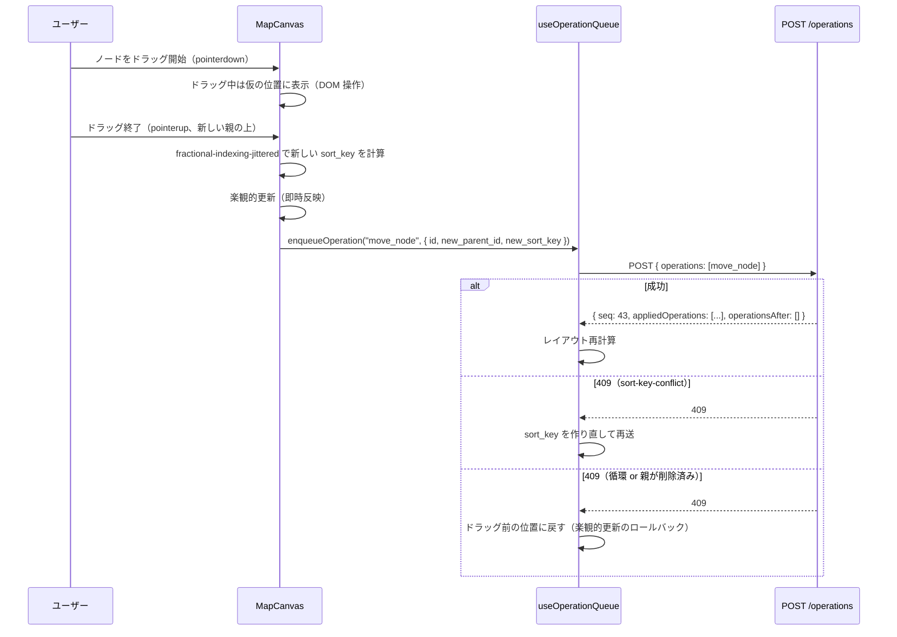

# 設計文書：マインドマップの編集（map）

## Overview

本設計はマインドマップの編集機能（MM-01〜MM-07、P1）を対象とする。マップの作成・一覧・削除（MM-01）、ノードの追加・編集・削除（MM-02）、ノードの移動（MM-03）、折りたたみ（MM-04）、自動レイアウト・ズーム・パン（MM-05）、キーボード操作（MM-06）、Undo/Redo（MM-07）を含む。

変更履歴の保持（D-02）、共同編集への備え（A-02、D-13）、行レベルセキュリティ（D-14）はP1から有効にする。

---

## Architecture



---

## Components and Interfaces

### バックエンドの層の構成（ADR 0035）

| 層 | 主なクラス・モジュール | 責務 |
|---|---|---|
| `domain` | `Mindmap`, `Node`, `NodeLink`, `MapOperation`, `SortKey` | エンティティ、値オブジェクト、ドメインルール（循環検出など） |
| `ports` | `MapRepository`, `NodeRepository`, `MapOperationRepository`, `MapSnapshotRepository`, `UnitOfWork` | DBアクセスの抽象 |
| `application` | `CreateMapUseCase`, `ListMapsUseCase`, `GetMapUseCase`, `UpdateMapUseCase`, `DeleteMapUseCase`, `ApplyOperationsUseCase`, `GetOperationsAfterUseCase` | ユースケース。認可・トランザクション境界 |
| `adapters` | `PgMapRepository`, `PgNodeRepository`, `PgMapOperationRepository`, `PgMapSnapshotRepository`, `PgUnitOfWork` | SQLAlchemy による実装 |
| `api` | `maps_router`, `MapResponse`, `MapCreateRequest`, `MapUpdateRequest`, `OperationBatchRequest`, `OperationBatchResponse` | FastAPI のルーター・Pydantic スキーマ |

#### 主なユースケース一覧

| ユースケース | 入力コマンド | 出力 |
|---|---|---|
| `CreateMapUseCase` | `CreateMapCommand(actor, title)` | `CreateMapResult(map_id)` |
| `ListMapsUseCase` | `ListMapsCommand(actor, cursor, limit)` | `ListMapsResult(items, next_cursor)` |
| `GetMapUseCase` | `GetMapCommand(actor, map_id)` | `GetMapResult(mindmap, nodes, node_links)` |
| `UpdateMapUseCase` | `UpdateMapCommand(actor, map_id, title)` | `UpdateMapResult(map)` |
| `DeleteMapUseCase` | `DeleteMapCommand(actor, map_id)` | `DeleteMapResult()` |
| `ApplyOperationsUseCase` | `ApplyOperationsCommand(actor, map_id, base_seq, operations, batch_id, client_id, origin, intent?)` | `ApplyOperationsResult(seq, operations_after)` |
| `GetOperationsAfterUseCase` | `GetOperationsAfterCommand(actor, map_id, after_seq)` | `GetOperationsAfterResult(operations)` |

`UpdateMapUseCase` は `title` の変更のみを受け付ける。論理削除は `DeleteMapUseCase` で行い、`mindmaps.deleted_at` を設定する。

`CreateMapUseCase` は、マップと中心のトピック（root_node）を**同じトランザクション内**で作成する。`mindmaps.root_node_id` → `nodes(map_id, id)` の外部キーは DEFERRABLE INITIALLY DEFERRED として定義し、コミット時に整合性を確認する（`docs/requirements/05a-tables.md` の制約定義に準拠）。

### ApplyOperationsUseCase の処理フロー



**スナップショット自動保存条件（D-16）**：
- 前回の操作から30分以上経過している、または
- 前回のスナップショットから200操作以上経過している

サーバーは各操作の `inversePayload` を組み立ててレスポンスに含める（後述「Undo / Redo の設計」参照）。

### 操作ログの適用

op_type と payload / inverse_payload の対応（詳細は `docs/requirements/05a-tables.md` の「操作ログの仕様」節に従う）：

| op_type | payload の主な内容 | inverse_payload | 409 拒否条件 |
|---|---|---|---|
| `create_node` | 新ノードの全項目（id, parent_id, sort_key, text, note, style, collapsed, is_floating, position_x, position_y） | 作成したノードの id | 親が存在しない・削除済み・別マップ。同 id の未削除ノードあり。sort_key が兄弟内で重複 |
| `delete_node` | 削除するノードの id | 削除した枝の全ノード・つながり線の削除前の全項目 | ルートノードを削除しようとした |
| `move_node` | id, new_parent_id, new_sort_key（必ず同時に送る） | 元の parent_id, sort_key | 循環ができる移動。親が削除済み。ルートを移動しようとした。sort_key が兄弟内で重複 |
| `update_node` | id, 変更した項目と新しい値 | 同じ項目の元の値 | ノードが存在しない・削除済み |
| `update_map` | 変更した項目（title, layout） | 同じ項目の元の値 | ― |
| `create_link` | つながり線の全項目 | 作成したつながり線の id | ※ P1 スコープ外 |
| `delete_link` | id | 削除前の全項目 | ※ P1 スコープ外 |
| `update_link` | id, 変更した項目と新しい値 | 同じ項目の元の値 | ※ P1 スコープ外 |

**バッチ適用のルール**：
- 1 つのバッチはすべて適用するか、1 件も適用しないかのどちらか（トランザクション境界と一致）
- 1 バッチの上限は 1,000 操作
- 同じ `batch_id` の再送は適用せず、前回の結果を返す（冪等性）

**項目単位の後勝ち（D-13）**：`update_node` / `update_link` / `move_node` は項目単位で後から届いた値を残す。同じ項目への変更は `seq` の大きいほうが残る。

**seq の採番（`docs/requirements/05a-tables.md` の適用の手順）**：サーバーは `mindmaps` の行を `SELECT FOR UPDATE` でロックしてから `seq` を採番する。`(map_id, seq)` の一意制約により、同じマップ内で `seq` は一意かつ単調増加することが保証される。

### 兄弟の並び順（sort_key：分数インデックス）

`sort_key` は COLLATE "C" の文字列比較で順序を表す分数インデックスを使う（D-01）。

**クライアント**が `fractional-indexing-jittered`（CC0）ライブラリを使って `sort_key` を生成する。サーバーは **形式** と **兄弟内の一意性** だけを検証する。

採番ルール：
- **末尾に追加**：既存の最大 `sort_key` より辞書順で大きい文字列を生成する。
- **兄弟間に挿入**：前の `sort_key` と後の `sort_key` の midpoint を計算する。
- **先頭に挿入**：既存の最小 `sort_key` より辞書順で小さい文字列を生成する。

**sort_key 衝突時の処理**：サーバーが兄弟内の重複を検出した場合、**409**（`/problems/sort-key-conflict`）を返す。クライアントは `sort_key` を作り直して再送する。rebalance は行わない。

### RLS とワークスペースの文脈（D-19）

`PgUnitOfWork.begin()` がトランザクション開始直後に以下を実行する：

```sql
-- set_config は is_local = true で現在のトランザクション中のみ有効
SELECT set_config('app.user_id', :user_id, true);
SELECT set_config('app.workspace_ids', :workspace_ids_array, true);
```

RLS ポリシーの形（全 workspace 所属テーブルに適用）：

```sql
-- USING (読み取り条件)
workspace_id = ANY(app_current_workspace_ids())
-- WITH CHECK (書き込み条件)
workspace_id = ANY(app_current_workspace_ids())
```

`app_current_workspace_ids()` の実装：

```sql
-- current_setting の missing_ok=true で未設定時は空文字列を返す
current_setting('app.workspace_ids', true)::uuid[]
```

このヘルパー関数はマイグレーションで作成する（ADR 0035 の手順に従う）。

### API エンドポイント

ワークスペースはパスに含めない（D-19）。

| メソッド | パス | 説明 | 成功時 |
|---|---|---|---|
| `GET` | `/api/v1/mindmaps` | マップ一覧（カーソルページング） | 200 |
| `POST` | `/api/v1/mindmaps` | マップ作成（冪等：同 id で再送したら既存を返す） | 201 |
| `GET` | `/api/v1/mindmaps/{mapId}` | マップ取得（全ノード・つながり線含む） | 200 |
| `PATCH` | `/api/v1/mindmaps/{mapId}` | マップ更新（title のみ） | 200 |
| `DELETE` | `/api/v1/mindmaps/{mapId}` | マップの論理削除 | 204 |
| `POST` | `/api/v1/mindmaps/{mapId}/operations` | 操作のまとまりを適用 | 200 |
| `GET` | `/api/v1/mindmaps/{mapId}/operations` | `?after={seq}` で指定 seq 以降の操作を取得 | 200 |

**`POST /api/v1/mindmaps/{mapId}/operations` のリクエスト／レスポンス**：

```typescript
// Request
{
  baseSeq: number,       // クライアントが認識している最新 seq
  batchId: string,       // UUIDv7（クライアント生成）
  clientId: string,      // タブを識別する ID
  origin: "user" | "ai" | "import" | "restore",
  intent?: string,       // "undo", "redo", "paste" など
  operations: Array<{
    id: string,          // UUIDv7（クライアント生成）
    opType: string,
    opVersion: number,
    payload: object
  }>
}

// Response
{
  seq: number,                  // このバッチに採番された最後の seq
  operationsAfter: Array<...>,  // baseSeq より後の他の操作（追いつき用）
  appliedOperations: Array<{    // 適用された各操作とその逆操作
    id: string,
    inversePayload: object      // サーバーが組み立てた inverse_payload
  }>
}
```

`delete_node` の `inversePayload` には、削除した枝のすべてのノードとつながり線の削除前の全項目が含まれる（後述「Undo / Redo の設計」参照）。

**ETag**：`GET /api/v1/mindmaps/{mapId}` のレスポンスに `ETag: "{last_seq}"` を付ける。

## Error Handling

### エラー一覧

| 状況 | ステータス | type |
|---|---|---|
| 循環する移動 | 409 | `/problems/circular-reference` |
| ルートノードの削除・移動 | 409 | `/problems/root-node-immutable` |
| 親ノードが存在しない・削除済み | 409 | `/problems/invalid-parent` |
| 同 id の未削除ノードあり（create_node） | 409 | `/problems/duplicate-node-id` |
| 存在しない・削除済みノードへの update/move | 409 | `/problems/node-not-found` |
| sort_key が兄弟内で重複 | 409 | `/problems/sort-key-conflict` |
| 1,000 操作超過 | 422 | `/problems/batch-too-large` |
| テキストが 1,000 字超、またはトピックが 2,000 個超 | 422 | `/problems/limit-exceeded` |
| 未認証 | 401 | — |
| マップが見つからない（または見る権限がない） | 404 | — |

ワークスペース非所属のマップへのアクセスは、存在を知らせないため 404 として扱う。

---

## Data Models

### `features/map` のファイル構成

```
src/features/map/
├── components/
│   ├── MapList.tsx           # マップ一覧（MM-01）
│   ├── MapEditor.tsx         # エディタ全体レイアウト（キャンバス + ツールバー）
│   ├── MapCanvas.tsx         # pan/zoom コンテナ（CSS transform）
│   ├── NodeElement.tsx       # 個々のノード（HTML div、絶対配置）
│   ├── EditableText.tsx      # インライン編集テキスト（IME 対応）
│   ├── CollapseToggle.tsx    # 折りたたみ丸ボタン
│   └── EdgeLayer.tsx         # 親子接続線 SVG レイヤー（P1 は親子接続線のみ）
├── hooks/
│   ├── useMapEditor.ts       # エディタ全体の初期化・データ取得
│   ├── useOperationQueue.ts  # 操作のキューイングと POST（楽観的更新・rebase）
│   ├── useUndoStack.ts       # Undo/Redo スタック管理
│   ├── useAutoLayout.ts      # d3-hierarchy によるレイアウト計算
│   ├── useKeyboardShortcuts.ts # キーボード操作（MM-06）
│   ├── useImeComposition.ts  # IME compositionstart/end フラグ
│   ├── usePanZoom.ts         # pan/zoom のポインターイベント処理（自前実装）
│   └── useCatchUp.ts         # 追いつき API ポーリング（画面復帰時 + 30 秒ごと）
├── store/
│   └── mapEditorStore.ts     # Zustand ストア
└── api/
    └── mapApi.ts             # TanStack Query のクエリ・ミューテーション定義
```

### Zustand ストア（MapEditorStore）

```typescript
interface MapEditorState {
  // 選択・編集状態
  selectedNodeId: string | null
  editingNodeId: string | null
  isComposing: boolean           // IME 変換中フラグ

  // Undo/Redo（D-15）
  undoStack: BatchOperation[]
  redoStack: BatchOperation[]

  // pan/zoom（MM-05）
  viewTransform: {
    scale: number
    translateX: number
    translateY: number
  }

  // 操作キュー
  pendingOperations: PendingBatch[]
  isSending: boolean             // 送信中フラグ（キューは1つずつ順に送る）
  lastAcknowledgedSeq: number

  // アクション
  selectNode(nodeId: string | null): void
  startEditing(nodeId: string): void
  stopEditing(): void
  setComposing(value: boolean): void
  pushUndo(batch: BatchOperation): void
  pushRedo(batch: BatchOperation): void
  clearRedo(): void
  setViewTransform(t: ViewTransform): void
  enqueueBatch(batch: PendingBatch): void
  acknowledgeBatch(batchId: string, seq: number): void
  rollbackBatch(batchId: string): void  // 409 時のロールバック
}
```

```typescript
// 型定義
interface BatchOperation {
  batchId: string
  operations: OperationSpec[]
  inverseOperations: OperationSpec[]  // Undo 用（サーバーの inversePayload から構成）
  intent?: string
}

interface PendingBatch {
  batchId: string
  baseSeq: number
  clientId: string
  origin: OperationOrigin
  intent?: string
  operations: OperationSpec[]
  optimisticNodes: NodeSnapshot[]  // ロールバック用のスナップショット
}
```

### 操作のクライアント側フロー（楽観的更新・キュー管理）

操作は NF-02（100 ミリ秒以内の応答）を満たすため、まずクライアントの状態に即時反映して画面に出す。サーバーへの送信は裏で行う。



**ノード追加時の即時フォーカス（MM-02、NF-02）**：サーバーの返事を待たずに `EditableText` にフォーカスして編集を始める。

**Undo の手順（D-15）**：
1. `undoStack` からバッチを取り出す
2. `intent = "undo"` として `inverseOperations` を POST する
3. 成功後、元のバッチを `redoStack` に積む

**Redo の手順**：
1. `redoStack` からバッチを取り出す
2. `intent = "redo"` として元の `operations` を POST する
3. 成功後、バッチを `undoStack` に戻す

### 追いつき API（`useCatchUp`）

P1 ではポーリングで実装する。画面復帰時と **30 秒ごと**に `GET /api/v1/mindmaps/{mapId}/operations?after={lastAcknowledgedSeq}` を呼び出し、受け取った操作を TanStack Query のキャッシュに反映する（D-13）。

P2 以降で SSE への移行を検討する（C-10）。

### 描画（ADR 0012）



| 要素 | 実装方式 |
|---|---|
| ノード | `<div>` の絶対配置。`left` / `top` を CSS で設定 |
| 親子接続線 | 1 枚の `<svg>` を重ね、`<path>` で描画。P1 では親子接続線のみ（node_links は P1 スコープ外） |
| pan/zoom | CSS `transform: translate() scale()`。**ADR 0012 のとおり自前の Pointer Events で実装**（d3-zoom は使わない） |
| レイアウト計算 | `d3-hierarchy`（左右展開。新規追加・移動・折りたたみのたびに再計算） |
| 文字幅測定 | `<canvas>` の `measureText()`（レイアウト計算の前に実行） |
| アニメーション | CSS `transition: left, top`（ノード移動時） |

**d3-hierarchy の左右展開ルール（MM-05）**：第1階層ノードは、左右の枝の数が均等になるように交互に割り振る。同数のときは右優先。

### 日本語 IME の扱い（MM-02）

`EditableText` コンポーネントで `compositionstart` / `compositionend` イベントを監視し、`isComposing` フラグを Zustand ストアに保持する。

| イベント | 処理 |
|---|---|
| `compositionstart` | `isComposing = true` |
| `compositionend` | `isComposing = false` |
| `keydown` で `Enter` かつ `isComposing = true` | 変換確定として扱う。ノードを増やさない |
| `keydown` で `Enter` かつ `isComposing = false` | 下に兄弟ノードを追加（MM-02）|

`editingNodeId` が設定されている間は、`useKeyboardShortcuts` のグローバルショートカット（矢印キー、Delete、Space、Ctrl+Z 等）を無効化する。ただし `Enter`・`Shift+Enter`・`Tab`・`Esc` は `EditableText` 側で処理する。

### ズーム・パンの保存（MM-05）

`viewTransform`（scale, translateX, translateY）は `localStorage` に保存する（キー：`thinkronos:map:{mapId}:view`）。別の端末やブラウザで開くと、中心から表示される（MM-05）。サーバーへの保存は不要。

### 折りたたみ（MM-04）

- ユーザーが `CollapseToggle` を押す、または `Space` キーを押す
- `update_node` 操作（`{ id, collapsed: !current_collapsed }` を payload）をキューに積む
- サーバーに POST → `nodes.collapsed` として永続化
- TanStack Query のキャッシュを更新後、`useAutoLayout` がレイアウトを再計算

---

## Undo / Redo の設計（MM-07、D-15）

### スタックの構造

```typescript
// undoStack[undoStack.length - 1] が直近の操作
undoStack: BatchOperation[]
redoStack: BatchOperation[]

// ページ再読み込みでスタックが消える（D-15）
// → Zustand ストアはメモリのみ（永続化しない）
```

### スタックの操作ルール

| 操作 | undoStack | redoStack |
|---|---|---|
| ユーザーが操作を行った | push | clear（新しい操作でやり直し履歴を消す） |
| Undo 成功 | pop | push（逆操作バッチ） |
| Redo 成功 | push（元の操作バッチ） | pop |
| 追いつき API で他の操作が来た | 変更しない | 変更しない（D-15） |

### `inverse_payload` の組み立て

**サーバー**が各操作の `inversePayload` を組み立て、`POST /operations` のレスポンスの `appliedOperations` フィールドに含める。クライアントはこの値を使って `undoStack` に積む。

`delete_node` の `inversePayload` には、削除した枝のすべてのノードとつながり線の削除前の全項目が含まれる。Undo 時は、**親から順に** `create_node`（同じ id を使い、論理削除されたノードを復活させる）を送る（`docs/requirements/05a-tables.md` の規則に準拠）。

---

## シーケンス図：主要フロー

### ノードを追加する（MM-02）



### ノードをドラッグして移動する（MM-03）



---

## Correctness Properties

テストツール：
- バックエンド（Python）：**Hypothesis**
- フロントエンド（TypeScript）：**fast-check**

以下の性質を `tests/unit/` および `tests/integration/` で確認する。

### Property 1: 操作ログの冪等性

同じ `batch_id` を 2 回送っても `nodes` と `map_operations` の状態が変わらない（結合テスト）。

**Validates: Requirements 8.5**

**テストツール**：Hypothesis（結合テスト）

### Property 2: 順序非依存の循環なし

任意の順序で `move_node` を適用しても、ノードが自分の子孫にならない（Hypothesis）。

**Validates: Requirements 3.4**

**テストツール**：Hypothesis（単体テスト：domain 層の循環検出）

### Property 3: ルート不変

`delete_node` / `move_node` でルートノードに対して必ず 409 を返す（結合テスト）。

**Validates: Requirements 2.8, 3.6**

**テストツール**：Hypothesis（結合テスト）

### Property 4: sort_key 一意性

兄弟の `sort_key` が重複しない（挿入・並べ替え後も）（単体テスト）。

**Validates: Requirements 3.2, 3.7**

**テストツール**：fast-check（フロントエンド単体テスト）

### Property 5: Undo-Redo 可逆性

操作 → Undo → Redo を繰り返しても元の状態に戻る（同一タブ・割り込みなしの条件下）（fast-check + Hypothesis）。

**Validates: Requirements 7.2, 7.3, 7.4**

**テストツール**：fast-check（フロントエンド）+ Hypothesis（バックエンド結合テスト）

### Property 6: スナップショット整合性

スナップショット + それ以降の操作を再生した結果が現在の `nodes` と一致する（Hypothesis、結合テスト）。

**Validates: Requirements 8.5**

**テストツール**：Hypothesis（結合テスト）

### Property 7: 認可

別ワークスペースのマップへの操作は RLS により 404 として拒否される（結合テスト：D-14、AU-03）。

**Validates: Requirements 10.1, 10.2**

**テストツール**：Hypothesis（結合テスト）


### Property 8: seq の一意性・単調増加

同じマップへの操作バッチを任意の順序・タイミングで送信しても、`map_operations` に記録された `(map_id, seq)` の組はすべて一意であり、`seq` は単調増加する。

**Validates: Requirements 8.7**

**テストツール**：Hypothesis（結合テスト）

---

## Testing Strategy

### テスト戦略（このフィーチャーの範囲）

### 単体テスト（`backend/tests/unit/`）

- `SortKey` の midpoint 計算ロジック
- domain 層の循環検出アルゴリズム
- `ApplyOperationsUseCase` の各 op_type の検証（ポートをモック）

### 結合テスト（`backend/tests/integration/`）

- Testcontainers + PostgreSQL 18（`thinkronos/postgres:18`）を使用
- `thinkronos_app` ロールで接続し、RLS が有効な状態で確認（ADR 0035、I-01）
- 上記 P-01〜P-07 の性質を確認
- マイグレーション：適用 → 戻す → 再適用

### フロントエンドテスト（`frontend/src/features/map/`）

- `EditableText`：IME フラグのテスト（compositionstart/end → Enter の振る舞い）
- `useUndoStack`：スタックの push/pop ルール
- `useAutoLayout`：d3-hierarchy の出力からノード座標が正しく計算されること
- `MapCanvas`：描画方式が ADR 0012（HTML + SVG + CSS transform）に従っていること

### E2E テスト（`frontend/e2e/`）

- スモーク：ログイン → マップ作成 → ノード追加（I-07、`create-map.spec.ts`）
- キーボード操作：Tab / Enter / Delete / Ctrl+Z が期待通りに動くこと（MM-06、MM-07）

---

## 未決事項

現時点で未決の事項はない。

---

## 依存ライブラリ

| ライブラリ | 用途 | ライセンス |
|---|---|---|
| `fractional-indexing-jittered` | sort_key の生成（クライアント） | CC0 |
| `d3-hierarchy` | ツリーレイアウト計算 | ISC |
| `@tanstack/react-query` | サーバーデータのキャッシュと再取得 | MIT |
| `zustand` | エディタ内状態管理 | MIT |
| `openapi-fetch` | 型安全な API クライアント | MIT |
