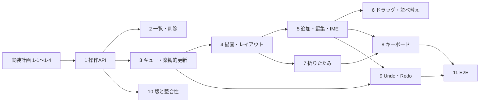

# Implementation Plan: マインドマップ編集（map）

## Overview

マインドマップ編集（MM-01〜MM-07、P1）の実装計画。Kiro が作った案（層ごとの分割）を、実装計画（`docs/requirements/11a-implementation-plan.md` の「3 マップの編集」）に合わせて、機能ごとの縦の分割に組み直した。各タスクは1つのPRで、API・画面・テストまでそろえて動く状態にする。

- 各タスクの「_要件_」は `requirements.md` の番号、「_性質_」は `design.md` の Correctness Properties の番号。
- テストは省略できない。各PRで、変更した行のカバレッジ80%以上（CI）と、そのタスクの性質のテストを入れる。
- 性質ベースのテストは、バックエンドが Hypothesis、フロントが fast-check。
- 前提のタスク（実装計画の 1-1〜1-4：初期のマイグレーション、登録とログイン、個人用ワークスペース、マップを作って表示する）は別のIssueで行う。タスク1は 1-1 と 1-4 が済んでいることを前提にする。

## Tasks

- [ ] 1. 操作API（実装計画 3-1、L 7時間）（Issue #85）
  - `map_operations`、`map_snapshots` のマイグレーション（`mindmaps` と `nodes` は実装計画 1-1 で作る）。`0002_workspaces.py` と同じ形のRLSポリシー、`thinkronos_app` への GRANT（`map_operations` は INSERT と SELECT だけ）、部分一意索引（ルート、兄弟の sort_key）、ダウングレード
  - domain：`Node`、`SortKey`（形式の検査）、`MapOperation`（8種類。P1 は node と map の5種類を受け付け、link の3種類は 422）、循環の検出、ルートの保護、上限（1,000字、2,000トピック）
  - ports：既存の `UnitOfWork` に、マップ・ノード・操作・スナップショットのリポジトリを足す
  - application：`ApplyOperationsUseCase`（行のロック、batch_id による再送の判定、検証、状態テーブルへの適用、seq の採番、inversePayload の組み立て）、`GetOperationsAfterUseCase`
  - api：`POST /api/v1/mindmaps/{mapId}/operations`、`GET /api/v1/mindmaps/{mapId}/operations?after=`。409・422・404 を RFC 9457 で返す。`make gen-openapi`、`make gen-types`
  - _要件: 2.8–2.12, 3.4–3.8, 8.5–8.7, 9.1, 10.1–10.3_
  - _性質: Property 1, 2, 3, 7, 8_
  - _依存: 実装計画 1-1、1-4_

- [ ] 2. マップの一覧、名前の変更、削除（3-2、M 3時間）（Issue #86）
  - api：`GET /api/v1/mindmaps`（カーソルページング）、`DELETE /api/v1/mindmaps/{mapId}`（204、論理削除）。名前の変更は `update_map` 操作で行う
  - 画面：`MapList`（新しい順、新規作成、名前の変更、削除）。一覧の取得は TanStack Query
  - _要件: 1.1, 1.3, 1.6–1.8_
  - _性質: Property 7_
  - _依存: Task 1_

- [ ] 3. 操作の送信の列（キュー）と楽観的更新（3-1の画面側、M 5時間）（Issue #87）
  - `mapEditorStore`（Zustand）：選択、編集、ノードの写し、未送信のバッチ、最後に確認した seq
  - `useOperationQueue`：先に画面へ反映し、1つずつ順に送る。operationsAfter の当て直し、sort-key-conflict の作り直し、409・422 の巻き戻しと取り直し、通信失敗・5xx の同じ batch_id での再送（間隔を延ばす）と「保存できていません」の表示
  - `useCatchUp`：開いたとき、画面に戻ったとき、30秒ごと
  - _要件: 8.1–8.4, 9.1–9.4_
  - _性質: Property 1（クライアント側：同じ batch_id の再送で二重に反映しない）_
  - _依存: Task 1_

- [ ] 4. エディタの描画、自動レイアウト、ズームとパン（3-3、L 6時間）（Issue #88）
  - `MapCanvas`（CSS transform）、`NodeElement`（HTML の絶対配置）、`EdgeLayer`（親子の線だけを SVG で）
  - `useAutoLayout`：d3-hierarchy で左右に展開。第1階層は少ない側（同数なら右）。文字幅は `measureText()`
  - `usePanZoom`：自前の Pointer Events。`localStorage`（`thinkronos:map:{mapId}:view`）に保存し、無い・壊れているときは中心から
  - 500トピックで操作から100ミリ秒以内（NF-02）を Playwright で測るテストを入れる
  - _要件: 5.1–5.8_
  - _性質: なし（レイアウトは例による確認）_
  - _依存: Task 3_

- [ ] 5. ノードの追加、編集、削除と IME（3-4、M 5時間）（Issue #89）
  - `EditableText`（textarea）と `useImeComposition`：変換中（isComposing、keyCode 229）はショートカットを処理しない。編集中の Enter は確定、Shift+Enter は改行、Tab は確定して子を追加、Esc は取り消し
  - 選択中の Tab／Insert（子）、Enter（下の兄弟）、Shift+Enter（上の兄弟）、F2・文字の入力（編集）、Delete（枝ごと削除）
  - 変換中の Enter で増えないことを、CDP で変換中を再現する Playwright のテストで確かめる（テスト計画の必須チェック）
  - _要件: 2.1–2.7, 2.6a, 2.6b_
  - _性質: なし_
  - _依存: Task 4_

- [ ] 6. ドラッグでの親の付け替えと並べ替え（3-5、M 4時間）（Issue #90）
  - ドラッグ中の表示、離した位置からの親と sort_key（fractional-indexing-jittered）の決定、循環で 409 のときの巻き戻し
  - Ctrl+↑／↓ での兄弟の入れ替え
  - _要件: 3.1–3.3, 3.7_
  - _性質: Property 4_
  - _依存: Task 5_

- [ ] 7. 折りたたみ（3-6、S 2時間）（Issue #91）
  - `CollapseToggle`（子があるときだけ）、Space、隠れている直下の子の数
  - _要件: 4.1–4.4_
  - _性質: なし_
  - _依存: Task 4_

- [ ] 8. キーボードでの選択の移動とズーム（3-7、M 3時間）（Issue #92）
  - 矢印（左右は親子、上下は兄弟）、Esc（選択の解除）、＋／−、F6
  - 編集中はグローバルのショートカットを止める
  - キーボードだけでマップを作る Playwright のテスト
  - _要件: 6.1–6.3_
  - _性質: なし_
  - _依存: Task 5, Task 7_

- [ ] 9. Undo と Redo（3-8、M 4時間）（Issue #93）
  - `useUndoStack`：返事の inversePayload から逆の操作を作る。intent = undo／redo。送信前のバッチの Undo は返事を待ってから送る。削除の Undo は親から順に create_node（同じ id の復活）。通信失敗・5xx は先頭に残し、409 は外して知らせる
  - 追いつきで届いた操作ではスタックを変えない
  - _要件: 7.1–7.6, 8.8_
  - _性質: Property 5_
  - _依存: Task 3, Task 5_

- [ ] 10. 自動の版の保存と整合性テスト（3-9、3-10、M 4時間）（Issue #94）
  - `ApplyOperationsUseCase` に自動のスナップショット（200操作、または30分空いたとき）を足す
  - スナップショットとその後の操作を再生した結果が nodes と一致することを、Hypothesis で作った操作の列で確かめる
  - _要件: 8.9, 8.10_
  - _性質: Property 6_
  - _依存: Task 1_

- [ ] 11. E2E（MM-06、MM-07）（Issue #95）
  - キーボードの操作（Tab／Enter／Shift+Enter／Delete／Ctrl+↑↓／矢印）と、Undo・Redo（削除した枝の復元、再読み込みでスタックが消える）。毎晩の E2E に入れる（I-07）
  - PRで必須のスモーク E2E（ログイン→マップ作成→ノード追加）は、実装計画 1-4 で作ったものを Task 5 で更新する
  - _要件: 6.1, 7.1–7.6_
  - _性質: Property 5_
  - _依存: Task 8, Task 9_

## 依存関係

## Notes

- Kiro の最初の案では、層（domain、ports、adapters、application、api）ごとにタスクを分けていた。その分け方では、最後の層ができるまで動くものが無く、PRごとの結合テストも書けないため、組み直した。
- バックエンドのテストは `thinkronos_app` ロールで接続し、RLS が有効な状態で実行する（ADR 0035、I-01）。
- `openapi.json` を変えるタスク（1、2）は、`make gen-openapi` と `make gen-types` を同じPRでコミットする（C-28）。
