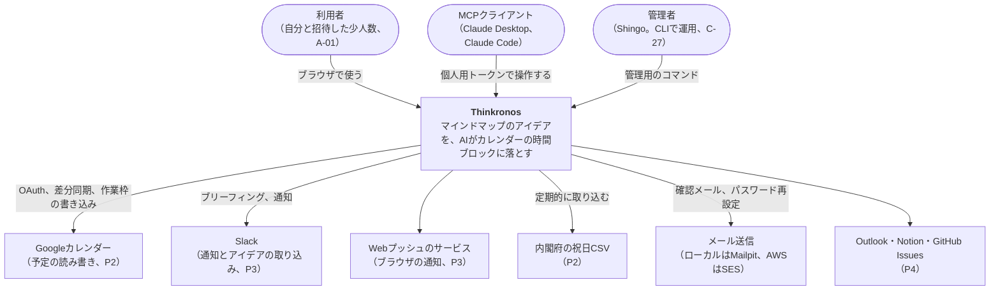
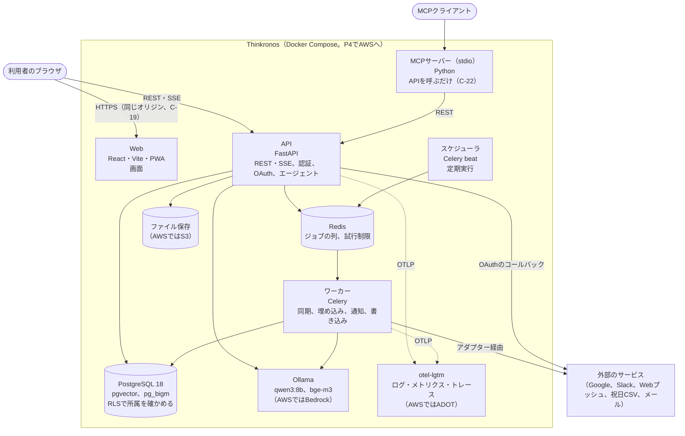

# C4の図

## コンテキスト図（レベル1）

Thinkronos と、利用者・外部のシステムの関係。

## コンテナ図（レベル2）

Thinkronos の中の、別々に動くもの（プロセスとデータの置き場）。

- API とワーカーは同じ application 層のユースケースを使う（ADR 0001）。
- アプリは、テーブルの所有者ではない `thinkronos_app` ロールで PostgreSQL に接続する（D-14）。
- LLM が外部に直接書き込むことはない。書き込みは利用者の承認のあとに、ワーカーが行う（ADR 0006）。
