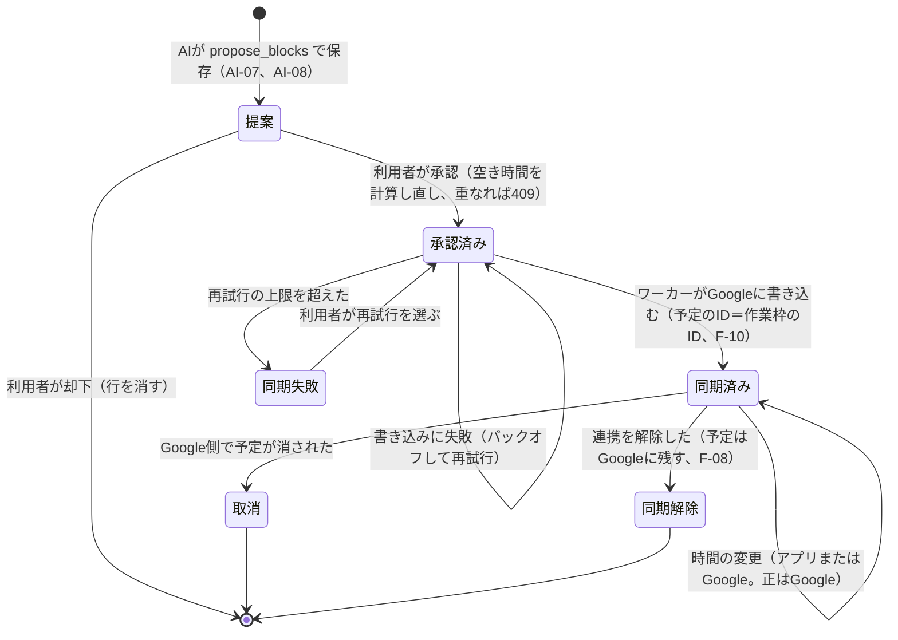
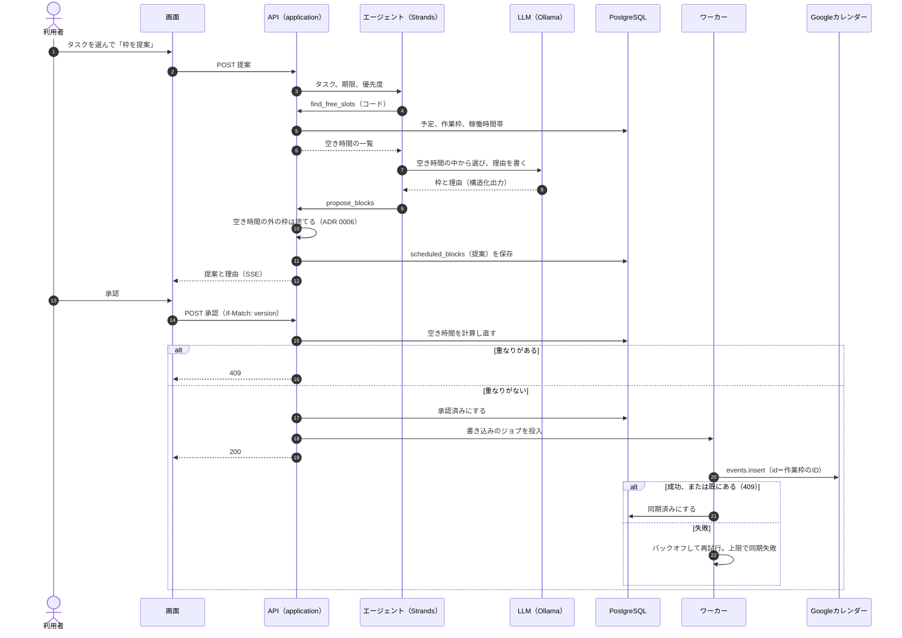
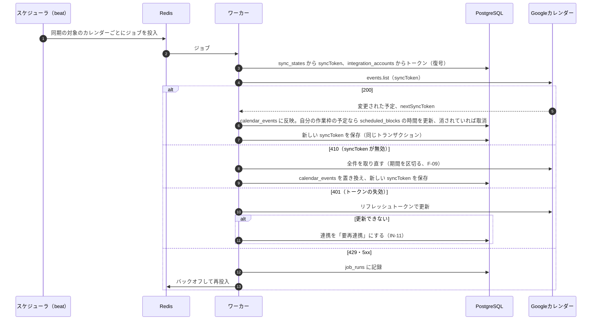

# 主要な処理の図

文章での説明は [04-architecture.md の「主な処理の流れ」](../requirements/04-architecture.md)。

## 作業枠の状態遷移（scheduled_blocks.status）

- 状態を変える更新は `version` で楽観ロックする（C-09）。画面とワーカーの更新がぶつかったら、後から来たほうが 409 になる。
- 「同期解除」のときの扱い（作業枠を残すか消すか）は F-08 で決める（Issue「[decide] 連携解除時の作業枠の扱い（F-08）」）。

## 自動スケジューリング（フロー3）

## Googleカレンダーの差分同期（フロー2）

- 同期の間隔（F-02）と、差分同期の範囲・繰り返し予定の扱い（F-09）は、P2 の前に決める。
