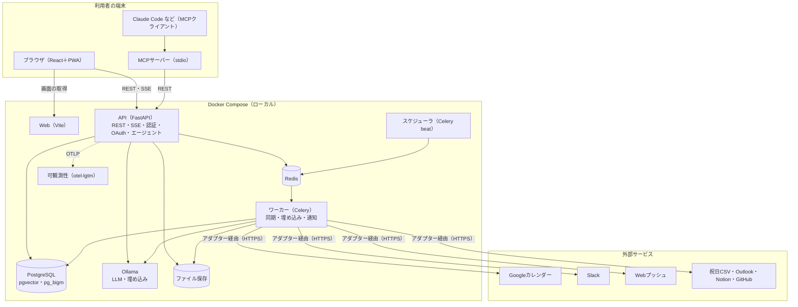
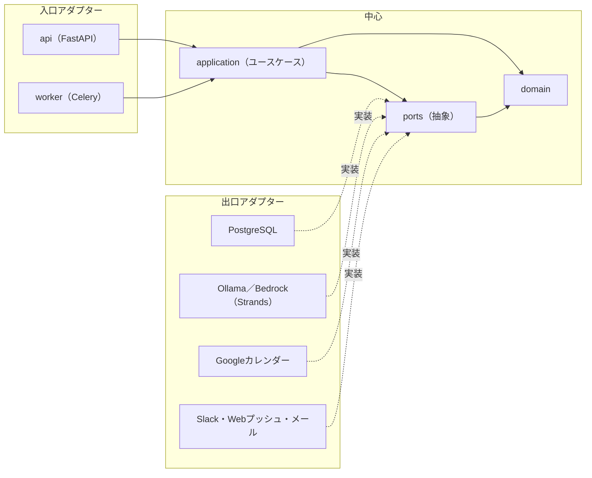

<!-- 正本はこのファイル。企画書（Claude Docs）から 2026-11-23 に移した（K-01）。変更はPRで行う。 -->

# システムアーキテクチャ

構成はAPI、ワーカー、定期実行（scheduler）の3つのプロセスにデータ層を加えたもので、すべてDocker Composeでローカルに起動する。外部サービスとの通信はすべてアダプターを通す。



AWS環境での置き換え先：PostgreSQL → RDS／Aurora、Ollama → Bedrock、ファイル保存 → S3、可観測性 → ADOT → CloudWatch・X-Ray。

ブラウザとMCPサーバーはAPIだけを呼び、重い処理と定期処理はRedis経由でワーカーが受け持つ。データ層の各箱の下段はAWS環境での置き換え先で、監視基盤は必要なときだけ起動する。

## ポート＆アダプター



組み立て（ポートとアダプターの結び付け）は `bootstrap.py` だけで行う（ADR 0035）。

フレームワークや外部サービスを知っているのは両端のアダプターだけで、domainは何にも依存しない。Strandsのエージェントも出口アダプターの1つとして扱い、applicationはAgentポートだけを呼ぶ。次の表は、ポートごとのローカルとAWS環境の実装。

| ポート | ローカルの実装 | AWS環境・将来の実装 |
| --- | --- | --- |
| LLM | Ollama（Strands経由） | Bedrock（Strands経由） |
| 埋め込み | Ollama | Bedrock |
| ストレージ | ローカルディスク | S3 |
| ジョブキュー | Celery＋Redis | Celery＋SQSまたはElastiCache |
| 認証 | 自前のJWT | Cognito |
| カレンダー | Google（P2） | Outlookを追加（P4） |
| 通知 | Slack | ― |
| タスクの書き出し | ― | Notion、GitHub Issues（P4） |

ルール：domain層とapplication層から、FastAPI、Strands、boto3を直接importしない。どの実装を使うかは、起動時に環境変数を読んで一箇所で組み立てる。

## ディレクトリ構成（backend）

```text
backend/
  app/
    api/          # FastAPIのルーター、リクエスト・レスポンスの型
    application/  # ユースケース（ノードを追加する、枠を提案するなど）
    domain/       # エンティティと業務ルール（フレームワーク非依存）
    ports/        # 抽象インターフェース（LLM、ストレージ、キュー、カレンダー、通知）
    adapters/     # 実装（Ollama・Bedrock、Google、Slack、PostgreSQLなど）
    agents/       # Strandsのエージェント定義とツール
    worker/       # Celeryのタスクと定期ジョブ
    mcp/          # MCPサーバー
  migrations/     # Alembic
  tests/          # unit、integration、eval
```

## 主な処理の流れ

フロー1：AIによる子ノードの提案（同期処理）

1. ブラウザがノードIDを付けて、提案APIを呼ぶ。
2. APIがルートからの経路と兄弟ノードを取得し、Strandsのエージェントに渡す。
3. エージェントがLLMで子ノード案を作り、Pydanticで形式を検証する。
4. 結果をSSEで逐次返す。利用者が採用したものだけをノードとして保存する。ブラウザはSSEをfetchで応答を読み続ける方式で受ける（C-19）。

フロー2：Googleカレンダーの差分同期（非同期処理）

1. Celeryの定期ジョブが、同期対象のカレンダーごとにジョブを投入する。
2. ワーカーがsyncTokenを付けて差分を取得し、calendar\_eventsに反映する。
3. 新しいsyncTokenをsync\_statesに保存する。失敗したらjob\_runsに記録し、バックオフして再試行する。

フロー3：自動スケジューリング（提案→承認→書き込み）

1. 利用者が対象のタスクを選び、提案APIを呼ぶ。
2. エージェントがfind\_free\_slotsで空き時間を取得し、期限と優先度から枠を選んで、propose\_blocksで「提案」として保存する。
3. 画面に枠と理由を表示し、利用者が承認する。承認の時点で空き時間を計算し直し、ほかの予定と重なっていれば承認を拒否する（409）。
4. 承認された枠をワーカーがGoogleカレンダーに書き込み（予定のIDは作業枠のID、F-10）、「同期済み」にする。失敗したら「承認済み」のまま再試行し、上限を超えたら「同期失敗」にする。Google側で予定が消されたら「取消」にする。

フロー4：ノードとタスクをまたぐ操作（D-21）

1. ノードからのタスク化（TK-01）、AIによるタスク分解の採用（AI-05）、マップからカレンダーへのドラッグ（CL-09）は、ノードの操作とタスク（と作業枠）の作成を、1つのユースケース・1つのトランザクションで行う。ノードの操作は操作ログにも記録する。
2. ノードを削除しても、タスクは自動では変えない。タスクは削除されたノードへのリンクを保ち、Undoでノードを戻すとリンクもそのまま戻る（TK-05）。
3. 画面は、タスクの元のノードが削除済みであることを表示し、タスクを消すかどうかは利用者が選ぶ。

## ジョブ一覧

ワーカーと定期実行（scheduler）で動く処理の一覧。細部は機能ごとの仕様で確定する。

| ジョブ | 起動の契機 | 冪等性と失敗時の扱い | フェーズ |
| --- | --- | --- | --- |
| Googleの差分同期 | 定期（ポーリング） | syncTokenで差分だけを取る。410なら全件同期からやり直す。範囲はF-09で決める | P2 |
| 作業枠のGoogleへの書き込み | 作業枠の承認 | 作業枠のIDを予定のIDにする（F-10）。再試行し、上限を超えたら「同期失敗」 | P3 |
| 埋め込みの作成 | ノードの作成・更新 | 最新の本文で上書きする | P2 |
| 朝のブリーフィング | 毎朝の定時 | 同じ日に二重に送らない（job\_runsで確認） | P3 |
| 作業枠の開始前の通知 | 定期 | 送信済みを記録し、二重に送らない | P3 |
| 祝日の取り込み | 定期（年に数回）と手動 | 全件を入れ替える | P2 |
| 保持期間による削除 | 毎日 | 何度実行しても結果は同じ（D-22） | P2 |
| 使われていないファイルの掃除 | 毎日 | どこからも参照されていないファイルだけを消す（D-06） | PX |

# 技術スタック

バックエンドはPython（FastAPI・Strands Agents）、データはPostgreSQL（pgvector・pg\_bigm）、LLMはローカルのOllama、フロントはReact（TypeScript）、実行はDocker Composeで確定。フロントのライブラリは候補の段階。

| レイヤー | 技術 | 用途 | 状態 |
| --- | --- | --- | --- |
| 言語 | Python | バックエンド全般とAI処理 | 確定 |
| 言語 | TypeScript | フロントエンド | 確定 |
| API | FastAPI＋Pydantic v2 | REST API、入力検証、OpenAPI定義の自動生成、SSE | 確定 |
| ORM | SQLAlchemy 2.0（async） | DBアクセス | 確定 |
| マイグレーション | Alembic | スキーマ管理 | 確定 |
| 非同期ジョブ | Celery＋Redis | 同期、埋め込み生成、定時通知 | 確定 |
| DB | PostgreSQL＋pgvector＋pg\_bigm | 業務データ、ベクトル検索、日本語の全文検索 | 確定 |
| AIエージェント | Strands Agents | エージェントとツールの定義、モデルの切り替え | 確定 |
| LLM・埋め込み | Ollama | ローカルでの推論と埋め込み生成 | 確定（モデルは未選定） |
| フロントエンド | React＋Vite | 画面 | 確定 |
| フロントエンド | TanStack Query、openapi-typescript | サーバー状態の管理、APIの型生成 | 候補 |
| マインドマップ描画 | React Flowか、自前のSVG・Canvas | ノードの描画、ドラッグ、ズーム | 候補（ADRで決定） |
| カレンダー描画 | FullCalendarなど | 月・週・日の表示、ドラッグ操作 | 候補（ADRで決定） |
| 実行環境 | Docker Compose | ローカルでの一括起動 | 確定 |
| CI | GitHub Actions | Lint、型チェック、テスト、ビルド | 確定 |
| IaC | Terraform | AWS環境の構成定義 | 確定（P4で適用） |
| 開発ツール | uv、Ruff、mypy、pytest、Testcontainers、Playwright、pre-commit | パッケージ管理、静的解析、テスト | 確定 |
| AI開発ツール | Kiro、Claude Code | 仕様駆動開発、実装とレビュー | 確定 |
| 可観測性 | OpenTelemetry、grafana/otel-lgtm（Prometheus、Loki、Tempo、Grafana） | ログ・メトリクス・トレースの収集と可視化 | 候補 |
| ログ | structlog | JSON形式の構造化ログ | 候補 |
| PWA | vite-plugin-pwa（Workbox） | マニフェストとService Workerの生成 | 候補 |
| リリース | git-cliff、GHCR | CHANGELOGの生成、コンテナイメージの公開 | 候補 |
| 品質・セキュリティ | commitlint、pip-audit、Trivy、gitleaks | コミット規約の検証、脆弱性と秘密情報の検出 | 候補 |
| AIレビュー | Claude Code GitHub Actions | PRの自動レビュー | 候補（導入は未決） |

Javaの経験との対応は、uvがGradle・Maven、SQLAlchemyがJPA、AlembicがFlyway、Pydanticが Bean Validation、pytestがJUnitにあたる。
