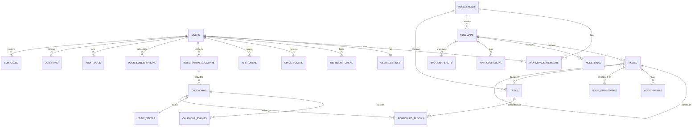

<!-- 正本はこのファイル。企画書（Claude Docs）から 2026-11-23 に移した（K-01）。変更はPRで行う。 -->

# データ設計

テーブルは6つの領域で全25個。データはワークスペースに属し（C-07）、外部連携は利用者個人に属する（F-07）。マップへの変更はすべて操作ログに残し（D-02）、正はnodesなどの状態テーブルに置く（D-12）。ワークスペースのテーブルは行レベルセキュリティで二重に守る（D-14）。列の型、制約、索引と、操作ログの仕様は、別タブにまとめた（D-16、D-17）。

テーブル定義と操作ログの仕様（別タブ）：テーブル定義と操作ログ

## 認証・利用者

| テーブル | 主な列 | 設計メモ |
| --- | --- | --- |
| users | id, email, password\_hash, display\_name, timezone, email\_verified\_at, status, created\_at, updated\_at, deleted\_at | emailは大文字と小文字を区別せずに一意。パスワードはArgon2idのハッシュだけを持つ（C-05、NF-05）。statusは「確認待ち・有効・停止中・削除済み」。一時的なログインのロックはRedisだけで持ち、停止中は管理者による停止に使い、管理用のコマンドで設定する（C-20、C-27） |
| user\_settings | user\_id, work\_hours, buffer\_minutes, notify\_time, notify\_channels, default\_write\_calendar\_id | 書き込み先のカレンダーと通知先を持つ。自動提案と通知の前提条件になる |
| refresh\_tokens | id, user\_id, token\_hash, family\_id, expires\_at, revoked\_at, created\_at | トークン本体は持たず、ハッシュだけを持つ。使うたびに新しいトークンへ交換し、古いトークンが再利用されたら同じfamilyをすべて無効にする（C-06） |
| email\_tokens | id, user\_id, purpose, token\_hash, expires\_at, used\_at | 確認メールとパスワード再設定に使う。1回限りで、有効期限は短くする |
| api\_tokens | id, user\_id, name, token\_hash, scopes, last\_used\_at, expires\_at, revoked\_at | MCPサーバー用の個人トークン（IN-06、E-05） |
| audit\_logs | id, user\_id, workspace\_id, action, target\_type, target\_id, metadata, created\_at | ログイン、連携の接続と解除、権限の変更などを残す。追記のみ。1年で削除する（D-22） |

## ワークスペース

| テーブル | 主な列 | 設計メモ |
| --- | --- | --- |
| workspaces | id, name, kind, created\_by, created\_at | kindは「個人用・共有」。登録時に個人用を1つ自動で作る |
| workspace\_members | workspace\_id, user\_id, role, joined\_at | 主キーは(workspace\_id, user\_id)。roleは「所有者・編集者・閲覧者」。今は所有者だけを使い、共同編集のときに広げる |

## マップ

| テーブル | 主な列 | 設計メモ |
| --- | --- | --- |
| mindmaps | id, workspace\_id, title, layout, root\_node\_id, last\_seq, created\_by, created\_at, updated\_at, deleted\_at | layoutは「マインドマップ」から始め、「組織図」「リスト」を後で追加する（B-03）。last\_seqは適用済みの最後の操作番号で、マップの版としてETagにも使う（C-09）。テンプレート（MM-22）はリポジトリのJSONファイルで持ち、テーブルは作らない |
| nodes | id, workspace\_id, map\_id, parent\_id, sort\_key, text, note, style, collapsed, is\_floating, position\_x, position\_y, created\_by, updated\_by, created\_at, updated\_at, deleted\_at | 隣接リスト＋sort\_key（D-01。sort\_keyの照合順序はCOLLATE "C"、D-17）。親と並び順は1つの操作で同時に変え、循環ができる移動はサーバーが拒否する（D-13）。浮いたトピックだけis\_floatingを真にして親を持たず、座標を持つ。それ以外は自動整列で位置を計算し、座標は保存しない（D-11）。textとnoteはMarkdownで持つ。styleには形・枠線・線の色・絵文字を入れる。textにpg\_bigmのインデックスを張る |
| node\_links | id, workspace\_id, map\_id, source\_node\_id, target\_node\_id, label, style, created\_by, created\_at, deleted\_at | つながり線（MM-13）。親子関係とは別に、任意の2つのトピックを結ぶ。同じ組の重複は一意制約で防ぐ |
| attachments | id, workspace\_id, node\_id, storage\_key, content\_type, size\_bytes, created\_by, created\_at, deleted\_at | トピックに貼る画像（MM-20）。本体はストレージのポート経由で保存し、ここには場所と種類だけを持つ（D-06）。マップの完全削除の後に残ったファイルは、定期ジョブで消す |
| map\_operations | id, workspace\_id, map\_id, seq, batch\_id, actor\_user\_id, client\_id, origin, intent, op\_type, op\_version, llm\_call\_id, payload, inverse\_payload, created\_at | すべての変更を、状態テーブルの更新と同じトランザクションで、追記だけで記録する（D-02、D-12）。seqはサーバーが付ける順序で、同じ項目への変更は後から届いた操作を残す（D-13）。(map\_id, seq)に一意制約を付ける。同じ操作の二重適用は、主キー（クライアントが生成するid）とbatch\_idで防ぐ。op\_typeは8種類（create\_node、delete\_node、move\_node、update\_node、create\_link、delete\_link、update\_link、update\_map）で、update系は変わった項目だけを持つ（D-15）。1回の利用者操作で出た操作はbatch\_idでまとめて1つのトランザクションで適用し、originに出どころ（user・ai・import・restore）、intentに意図（貼り付け、AIの採用、Undoなど）を持つ。op\_versionは操作の形式の版で、形式を変えても古い操作を再生できるようにする。Undoはクライアントのスタックで管理し、逆の操作を新しいまとまりとして追記する。inverse\_payloadは変更履歴の画面と調査に使う |
| map\_snapshots | id, workspace\_id, map\_id, seq, kind, label, format\_version, content, created\_by, created\_at | 自動の版（前回の操作から30分以上空いたとき、または前回の版から200操作）と、利用者が名前を付けた版（MM-18）の2種類で、マップ全体を保存する。すべて残し、操作ログも消さない。復元は、選んだ版と今の状態の差分を新しい操作として追記する（D-16） |
| node\_embeddings | node\_id, model\_id, workspace\_id, dimension, embedding, source\_hash, updated\_at | 主キーは(node\_id, model\_id)。HNSWインデックス。モデルを変えたら作り直す |

## タスク・予定

| テーブル | 主な列 | 設計メモ |
| --- | --- | --- |
| tasks | id, workspace\_id, node\_id, title, estimate\_minutes, due\_on, priority, status, assignee\_user\_id, created\_by, completed\_at, version | node\_idは一意かつNULL可（ノードと1対1）。assignee\_user\_idは共同編集に備えた列で、今は作成者が入る |
| scheduled\_blocks | id, workspace\_id, task\_id, user\_id, calendar\_id, start\_at, end\_at, status, proposal\_reason, external\_event\_id, version | user\_idは「誰のカレンダーに入れる枠か」。statusは「提案・承認済み・同期済み・同期失敗・取消・同期解除」。承認の時点で空き時間を計算し直す（フロー3） |

## 外部連携

| テーブル | 主な列 | 設計メモ |
| --- | --- | --- |
| integration\_accounts | id, user\_id, provider, external\_account\_id, account\_label, granted\_scopes, access\_token\_enc, refresh\_token\_enc, token\_key\_id, expires\_at, status, last\_error, settings, connected\_at, updated\_at | 利用者個人に属する（F-07）。providerは「google・microsoft・slack・notion・github」。(provider, external\_account\_id)に、解除済みの行を除いた部分一意制約。statusは「接続中・要再連携・解除済み」。token\_key\_idで暗号鍵の入れ替えに対応する。Slackの通知先などはsettingsに持つ |
| calendars | id, user\_id, integration\_account\_id, external\_calendar\_id, name, color, is\_primary, sync\_enabled, include\_in\_free\_busy, can\_write | include\_in\_free\_busyで空き時間の計算に含めるかを選ぶ。書き込み先にできるのはcan\_writeのカレンダーだけ |
| calendar\_events | id, user\_id, calendar\_id, external\_event\_id, etag, start\_at, end\_at, start\_date, end\_date, all\_day, summary, recurring\_event\_id, transparency, status, updated\_at | 連携先の予定の写し。終日の予定は、日付のずれを防ぐためstart\_dateとend\_date（date）で持つ（D-20）。(calendar\_id, external\_event\_id)に一意制約。transparencyで「予定あり・空き」を区別する |
| sync\_states | calendar\_id, user\_id, cursor, last\_synced\_at, consecutive\_failures, last\_error | cursorには、GoogleのsyncTokenやMicrosoft GraphのdeltaLinkを入れる。連携先の違いをこの1列で吸収する |
| push\_subscriptions | id, user\_id, endpoint, p256dh, auth\_enc, created\_at | Web Pushの購読情報。購読切れの応答を受けたら削除する |

## 運用

| テーブル | 主な列 | 設計メモ |
| --- | --- | --- |
| job\_runs | id, user\_id, type, status, attempts, last\_error, created\_at, finished\_at | ジョブの状態画面（OP-01）に使う。180日で削除する（D-22） |
| llm\_calls | id, user\_id, purpose, provider, model, input\_tokens, output\_tokens, latency\_ms, result\_count, created\_at | LLM呼び出しの記録（NF-20）。提案した件数（result\_count）を持ち、採用率はmap\_operationsのllm\_call\_idと合わせて出す（E-03）。180日で削除する（D-22） |
| holidays | date, name, updated\_at | 日本の祝日（CL-06）。内閣府の祝日CSVを定期取得して入れ替える。全利用者で共有するので、RLSの対象外 |

## 共通ルール

- 主キーはUUIDv7で、クライアントでも生成できる（C-08）。
- ワークスペースに属するデータには必ずworkspace\_idを持たせ、すべての検索で所属を確認する。子テーブル（nodes、node\_links、map\_operations、map\_snapshots、node\_embeddings、scheduled\_blocks）にも持たせ、(workspace\_id, map\_id)などの複合外部キーで親と一致させる。
- 行レベルセキュリティ（RLS）を二重の守りとして使う（D-14）。アプリはテーブルの所有者ではない専用のロールで接続し、トランザクションの最初に、所属するワークスペースの一覧とuser\_idを設定する。ポリシーは workspace\_id = ANY(所属の一覧) の形にし、役割による制御はアプリ層で行う（D-19）。マイグレーションは所有者のロールで行う。利用者をまたぐワーカーのジョブは、対象の一覧を作るところだけBYPASSRLSを持つロールを使い、1件ずつの処理は通常のロールで文脈を設定して行う。ポリシーは行自身の値だけを見る形にする。
- RLSの対象は、P1ではワークスペースに属するテーブルとする。利用者個人に属する連携系のテーブル（F-07）にはP2でuser\_idのポリシーを足し（calendarsなどの子テーブルにもuser\_idを持たせる）、ログイン前に使う認証系のテーブルは対象外とする。
- 不変条件はDBでも守る（D-17）。複合外部キーで親子とつながり線を同じマップの中に限り、CHECK制約と部分一意索引を使う。循環はアプリ層で検査し、整合性テストで確かめる。
- 複合外部キーで一部の列だけNULLにするときは、列を指定した ON DELETE SET NULL を使う（PostgreSQL 15以上、D-18）。対象は tasks.node\_id（マップの完全削除時）、scheduled\_blocks.calendar\_id と user\_settings.default\_write\_calendar\_id（連携の解除時）。
- 日時はtimestamptzでUTCとして保存する。論理削除はdeleted\_atで表す。
- 画面と同期ジョブの両方から更新されるテーブル（tasks、scheduled\_blocks）はversionの列を持ち、ETagとIf-Matchで楽観ロックする（C-09）。マップの編集は操作APIで行い、サーバーが順序を決めて項目単位で後勝ちにする。マップの版はmindmaps.last\_seqで表し、nodesとnode\_linksはversionを持たない（D-13、C-09）。
- パスワードと各種トークンは平文で持たない。ハッシュか、暗号化した値だけを持つ。
- ログイン試行の回数は、アカウントとIPアドレスの組でRedisで数え、待ち時間を段階的に延ばす（C-20）。
