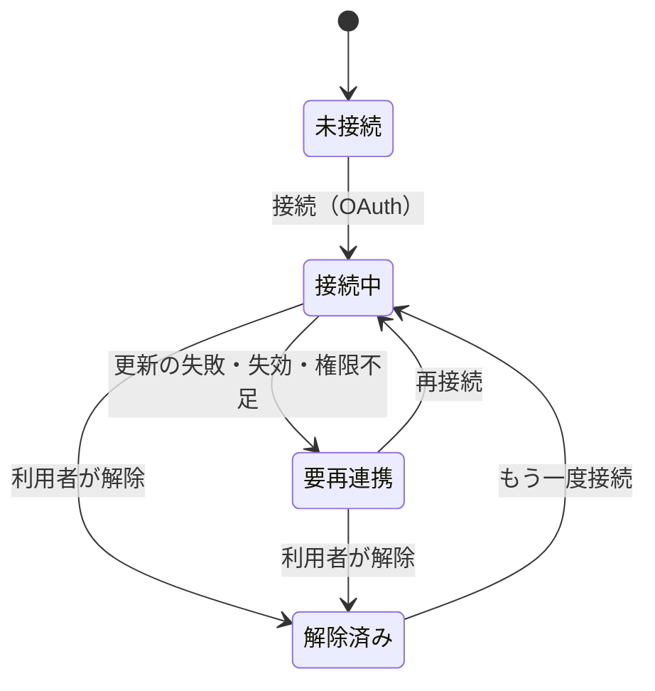

<!-- 正本はこのファイル。企画書（Claude Docs）から 2026-11-23 に移した（K-01）。変更はPRで行う。 -->

# 外部API連携設計

連携先はすべて「ポート＆アダプター」で隔離し、OAuth、トークン保存、リトライ、同期状態は共通部品にする。本丸はGoogleカレンダーで、2社目のOutlookで抽象化が正しかったかを検証する。

## 連携先一覧

| 連携先 | 目的 | 方式 | ローカルでの動作 | フェーズ |
| --- | --- | --- | --- | --- |
| Googleカレンダー | 予定の読み書き | OAuth 2.0＋REST API、syncTokenによる差分同期 | ポーリングで動く | P2 |
| 日本の祝日データ | 祝日の表示 | 内閣府が公開する祝日CSVを定期取得 | 動く | P2 |
| Slack | 毎朝の通知、アイデアの投入 | Botトークン、Socket Mode | Socket Modeなら公開URLなしで動く | P3 |
| MCP | Claudeからの操作 | MCPサーバー（stdio）。APIを呼ぶ薄いクライアントで、個人用トークンで認証する（C-22） | 動く | P3 |
| Outlook | 2つ目のカレンダー | Microsoft Graph＋OAuth 2.0 | ポーリングで動く | P4 |
| Notion | タスクの書き出し | Notion API | 動く | P4 |
| GitHub Issues | タスクの書き出し | GitHub REST API | 動く | P4 |
| Googleのプッシュ通知 | 変更の即時反映 | Webhook | 動かない（公開HTTPSのURLが必要） | P4 |

## 共通部品

| 部品 | 役割 |
| --- | --- |
| ポート | CalendarProvider（予定の取得・作成・更新・削除、差分同期）、Notifier（通知）、TaskExporter（タスクの書き出し）。連携先ごとにアダプターを実装する |
| OAuth | 認可コードフロー＋PKCE。stateパラメータでCSRFを防ぐ。連携・解除・再連携の画面を持つ |
| トークン保存 | integration\_accountsに暗号化して保存。期限切れの前に自動で更新し、失効したら「要再連携」にする |
| リトライ | 指数バックオフ＋ジッター。Retry-Afterヘッダーがあれば従う |
| エラー分類 | 再試行できる（タイムアウト、429、5xx）、再連携が必要（invalid\_grant、401）、恒久的（400、権限不足）の3種類に分ける |
| 同期状態 | sync\_statesに次回用のトークン、最終同期日時、直近のエラーを持つ |

## Googleカレンダー同期の流れ

1. 初回は全件を取得し、応答に含まれるnextSyncTokenを保存する。
2. 2回目以降はsyncTokenを付けて差分だけを取得し、calendar\_eventsに反映する（Celeryの定期ジョブ）。
3. syncTokenが無効と返されたら（410）、全件同期からやり直す。syncTokenは期間などの条件と組み合わせられないため、最初の同期の範囲と繰り返し予定の扱いはF-09で決める。
4. アプリから予定を書き込むときは、拡張プロパティにscheduled\_blocksのIDを入れ、アプリが作った予定だと識別できるようにする。予定のIDには作業枠のID（UUIDからハイフンを除いた文字列）を指定し、再試行しても二重にできないようにする（F-10）。
5. 利用者がGoogleカレンダー側で枠を動かした場合は、Google側の変更を正として、アプリの枠を更新する。

## Google連携で最初に対処すること

- テスト中のアプリは、認可とリフレッシュトークンが7日で失効する（C-04）。失効を検知して再連携を促す画面を、P2の最初に作る。
- カレンダーのスコープは機密性が高い扱いなので、一般公開する場合は審査が必要（C-05）。この計画の範囲ではテストユーザーのみで使う。

# 連携先アカウントと機能の利用条件

マップ、タスク、AIによる発想支援は、アカウント登録だけで使える。外部サービスを使う機能は、対応する連携先のアカウント接続を必須にする（F-06）。判定はサーバー側で行い、画面はその結果に従って案内を出す。

## 機能と必要な連携

| 機能 | 対応する要件 | 必要な連携 | 未接続のとき | 要再連携のとき |
| --- | --- | --- | --- | --- |
| マインドマップ、タスク、AIによる発想支援、検索 | MM、TK、AI-01〜06 | なし | ― | ― |
| カレンダーの表示と同期 | CL-01〜08、IN-03、IN-07 | GoogleカレンダーかOutlookの、どちらか1つ以上 | カレンダー画面に接続の案内を出す | 写しの予定は表示するが、同期を止めて再接続を促す |
| 作業枠の自動提案と書き込み | AI-07〜09 | カレンダー連携と、書き込み先カレンダーの設定 | 提案ボタンを無効にし、理由を表示する | 提案を止める（古い予定で空き時間を計算しないため） |
| 朝のブリーフィングと作業枠の通知 | AI-10、IN-04、PW-05 | Slack連携か、Web Pushの購読のどちらか | 通知先の選択肢に出さない | Slackへの送信を止め、アプリ内に表示する |
| Slackからのアイデア追加 | IN-05 | Slack | 設定画面に接続の案内を出す | 受け付けを止める |
| タスクの書き出し | IN-08、IN-09 | NotionかGitHub | 書き出しボタンを無効にする | 書き出しを止め、再接続を促す |
| Claudeからの操作 | IN-06 | 個人用トークンの発行（外部アカウントは不要） | ― | トークンが無効なら401を返す |

## 制御の仕組み

1. 使える機能（ケイパビリティ）をサーバーで計算する。連携アカウントの状態、許可された権限（スコープ）、設定から、calendar.read、calendar.write、schedule.propose、notify.slack、notify.push、export.notion、export.githubを導く。
2. 判定はapplication層で行う。各ユースケースの最初でCapabilityPolicyが判定し、条件を満たさなければ処理を始めない。画面での非表示は案内のためで、守りの本体ではない。
3. 画面は `/api/v1/me/capabilities` の結果に従い、使えない機能には理由（未接続、要再連携、権限不足）と接続ボタンを表示する。
4. エラー応答はRFC 9457の形式にし、種類を `integration-required` として、必要な機能、連携先の候補、理由を返す。HTTPステータスは409を推奨する。
5. 権限は段階的に求める。接続時は必要最小限にし、別の機能を有効にするときに、足りない権限だけを追加で求める。
6. 接続、再接続、解除、失効の検知は、監査ログ（audit\_logs）に残す。

## 連携アカウントの状態

要再連携は、リフレッシュトークンでの更新に失敗したとき（Googleのテスト中のアプリでは7日で失効する）、または必要な権限が足りないときに入る。要再連携の間は、関係する機能を止め、画面上部に再接続の案内を出し続ける。

## 解除するときの扱い

- トークンは、連携先の失効APIで無効にしてから削除する。
- 予定の写しと同期の状態は、すぐに削除する（D-10）。
- 同期済みの作業枠は連携先のカレンダーに残し、アプリ側では「同期解除」の状態にする（F-08で確定する）。
- 解除しても、マップとタスクは消えない。

## 所有と共有のルール

- 連携アカウントは利用者個人に属し、ワークスペースには属さない（F-07）。
- 共有ワークスペースでも、作業枠の提案と書き込みには操作する本人のカレンダーだけを使い、他のメンバーのトークンは使わない。
- 同じ外部アカウントを、複数のThinkronosアカウントに接続することはできない（解除済みを除いて、providerと外部アカウントIDの組に一意制約を付ける）。
- 複数のカレンダーを接続した場合、空き時間の計算には「空き時間の計算に含める」設定のカレンダーをすべて使い、作業枠の書き込み先は1つに決める。
