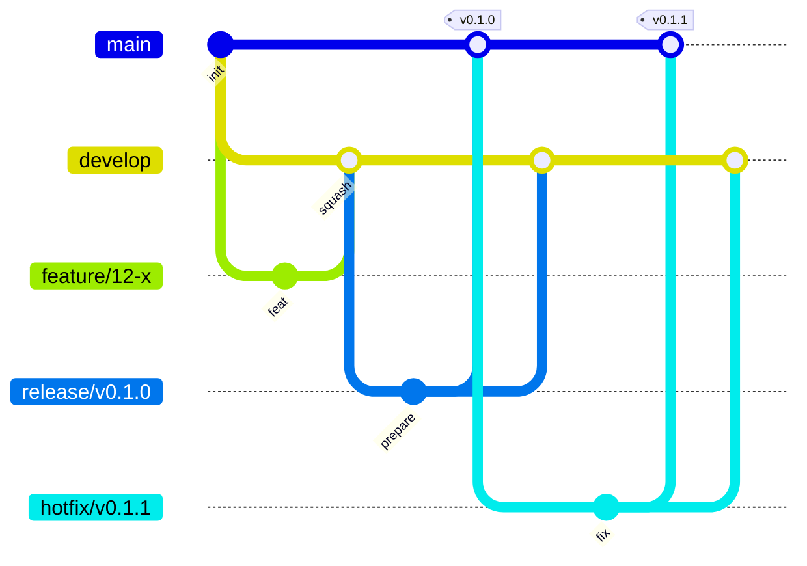

<!-- 正本はこのファイル。企画書（Claude Docs）から 2026-11-23 に移した（K-01）。変更はPRで行う。 -->

# 開発プロセスの共通ルール

全工程に共通するルールは、ADRの運用と完了の定義の2つ。AIツールの使い分け、ブランチ戦略とリリース管理、CI/CD、監視基盤、PWAは、このあとの各章で定める。

## ADRの運用

- 置き場所は `docs/adr/NNNN-タイトル.md`。項目は「背景、選択肢、決定、結果（トレードオフ）」の4つ。
- 書くタイミング：複数の選択肢を比較したとき、あとから「なぜ？」と聞かれそうな判断をしたとき。

## 完了の定義（Definition of Done）

- [ ] 対応するIssueがあり、受け入れ条件を満たしている
- [ ] 仕様（Kiroの仕様書か設計メモ）がある
- [ ] テストを追加し、CIの必須チェックがすべて通っている。ワークスペースのデータを扱うAPIでは、別のワークスペースのデータに触れないことを結合テストで確かめた（I-01）
- [ ] AIレビューとセルフレビューの指摘すべてに返信した
- [ ] 設計判断があればADRを書いた
- [ ] 必要なログとメトリクスを追加した
- [ ] READMEや関連ドキュメントを更新した

# AI開発ツールの役割分担と運用（Kiro・Claude Code）

原則は「Kiroで決めて、Claude Codeで作り、自分が判断する」。仕様と設計の判断、最終レビュー、マージは自分が持ち、AIは下書き、実装、一次レビューを担う。

## 役割分担

| 工程 | Kiro | Claude Code | 自分 |
| --- | --- | --- | --- |
| 要件・仕様 | 設計から始める流れ（Design-First）で作り、要件の分析（Analyze Requirements）で矛盾と抜けを見つける。要件は docs/ の要件IDを参照する（G-20） | ― | 内容を確認して承認する |
| 設計 | design.mdを作る | 既存コードとの整合を調べる | 判断し、ADRに残す |
| タスク分解 | tasks.mdを作る | ― | Issueに登録し、優先順位を決める |
| 実装 | 小さな機能なら任せてもよい | tasks.mdの項目を実装し、テストを書く | 差分を全行読む |
| レビュー | ― | PRを出す前のローカルレビュー（自動化は要検討） | 指摘の採否を決め、マージする |
| ドキュメント | ―（更新漏れの検知はCIで行う。G-21） | READMEとADRの下書き | 確定させる |
| 規約 | AGENTS.mdを読む。Kiro専用の指示は `.kiro/steering/` | `CLAUDE.md`（`@AGENTS.md` を取り込む） | AGENTS.mdを正に保つ（G-10） |

## 使い分けの基準

- Kiroを使う：新しいドメインを含む機能、複数のレイヤーをまたぐ機能、外部連携、AI機能。仕様駆動の対象は「マップのデータモデルと操作」「Googleカレンダー同期」「自動スケジューリング」の3つで、余力があればSlack連携とPWAも加える。原因の分かりにくいバグには、バグ修正用の仕様（Bugfix Spec）を使う。
- Claude Codeだけで進める：1つのPRに収まる修正、リファクタリング、テストの追加、バグ修正、依存ライブラリの更新への追従。
- Kiroは無料のプラン（月50クレジット）から始める。P0で1つの仕様に使ったクレジットを記録し、足りなければ、初回のアップグレードの特典（その月の残りのProが無料、12か月有効な500の試用クレジット）を、仕様を集中して作る月に使う（C-07、G-20）。

## 1つの機能を作る流れ

1. 機能のIssueを立てる（テンプレートを使う）。
2. 大きな機能なら、先に機能の「使い方」ページ（docs/guide/）を書き（K-07）、それを入力にKiroで仕様を作り `.kiro/specs/<機能名>/` に置く。design.mdの中の判断はADRに切り出す。仕様は設計から始める流れで作り、要件の分析で矛盾と抜けを確かめ、マップの不変条件は正しさの確認（性質ベースのテスト）で確かめる。要件は docs/ の要件IDを参照し、書き直さない（G-20）。
3. tasks.mdの各項目をサブIssueにし、1項目＝1ブランチ＝1PRにする。
4. Claude Codeで実装し、ローカルでセルフレビューしてからPRを出す。
5. PRではCIとAIレビューが動く。指摘の採否は自分が決め、理由を返信に残す。
6. マージ後に仕様と実装がずれていたら、specsを更新する。

## 運用ルール

- AIが書いたコードも、差分を全行読んでからマージする。
- `.env` やトークンなどの秘密情報は、AIツールの読み取り対象から外す。
- 規約の正はリポジトリ直下のAGENTS.mdにする。CLAUDE.mdはAGENTS.mdを取り込み、Kiroのsteeringには、Kiro専用の指示と docs/ へのファイル参照だけを置く（G-10）。MoneyNoteWebで `CLAUDE.md` と `copilot-instructions.md` を揃えたのと同じ運用にする。
- テスト、Lint、文書の更新漏れの確認は、ツールに依存しないpre-commitとCIで行う。Kiroのフックは、Kiroで作業するときのシェルコマンドの動作（Lintなど）だけに使い、エージェントへの指示を差し込む動作は使わない（G-21）。
- PRの自動レビューは、Claude Code GitHub Actions（`anthropics/claude-code-action`）で実現できる。当面は、ローカルのClaude Codeに差分をレビューさせて結果をPRに貼る手動運用とする。APIの利用料がかかるため、自動化はP1の終わりに再検討する（[公式ドキュメント](https://code.claude.com/docs/en/github-actions)）。
- Kiroの無料と個人のプランでは、オプトアウトしない限り入力がサービスの改善に使われることがあるため、導入時にデータ共有をオプトアウトする。無料のプランでは、不正利用の検知のために入力が最大60日保存される。非公開の企画書の内容は、Kiroに渡さない。
- 機能ごとに、使ったツール、Kiroのクレジット、手戻り、気づきを `docs/tool-notes.md` に記録し、あとで振り返れる形にする。

* セッションの切り替え：Claude Codeは1つのサブIssue（1つのPR）ごとに新しいセッションにし、このチャットは1つのテーマか1つの作業ごとに新しいチャットにする。引き継ぎはIssue、PR、docs/ に残す（G-23）。
* エージェント戦略：P0のIssue 9で、カスタムエージェント（設計レビュー、テスト作成、文書の整合チェック）、スキル（ADR、Issueへの分解、マイグレーション、E2E）、フック（整形、mainの保護）の型を作る（G-24）。

# ブランチ戦略・PR・レビュー・リリース管理

1人開発でも、チーム開発と同じ手続きを仕組みで強制する。ブランチはGit-flowを簡略化した5種類、マージはPR経由だけ、リリースはSemVerのタグとCHANGELOGで管理する。

## ブランチ戦略

`spike/<Issue番号>-…` は試作用で、どこにもマージしない。

Git-flowを選ぶのは、業務システムの実案件で多い「リリースブランチ」「hotfix」「バックマージ」の手順を練習でき、ブランチと環境（develop＝開発、main＝本番相当）を対応させやすいため。GitHub Flowと比較したうえでGit-flowに決定し、理由はADR 0013に残す。

| ブランチ | 分岐元 | マージ先 | 用途 | マージ方式 |
| --- | --- | --- | --- | --- |
| main | ― | ― | リリース済みのコード。タグはここにだけ打つ | ― |
| develop | main | ― | 次のリリースに向けた統合 | ― |
| feature/\<Issue番号>-<概要> | develop | develop | 1つのIssue（tasks.mdの1項目）。寿命は数日 | Squash merge |
| release/vX.Y.0 | develop | mainとdevelop | リリース準備（バージョン更新、CHANGELOG、最終確認）。新機能は入れない | Merge commit |
| hotfix/vX.Y.Z | main | mainとdevelop | リリース済みバージョンの緊急修正 | Merge commit |

## ルールセット（確定）

管理者（自分）も例外にしない（G-02）。GitHubでは自分のPRを自分で承認できないため、承認の件数は0にし、必須チェックとPRテンプレートのチェックリストで品質を担保する。GitHub上のルールセット名は、表の上から順にmain、develop、release-hotfix、release-tags。

| ルールセット | 対象 | 設定 |
| --- | --- | --- |
| main保護 | main | PR必須（承認0件）、許可するマージ方式はMerge commitのみ、会話の解決を必須、必須チェック、ブランチを最新に保つ、force pushと削除を禁止 |
| develop保護 | develop | PR必須（承認0件）、Squash mergeとMerge commitを許可、会話の解決を必須、必須チェック、force pushと削除を禁止 |
| リリース作業用 | release/*、hotfix/* | force pushを禁止。リリース準備のコミットは直接pushしてよい |
| タグ保護 | タグ v\* | 更新と削除を制限する（設定済み）。作成の制限は、release.ymlを作るP1で有効にし、例外をリリース用のGitHub Actionsだけにする |

必須チェックは、ci（backendとfrontend）、security、pr-title、branch-policyの4種類。CIのワークフローを作るP0の時点で追加する。公開リポジトリなので、これらはすべて無料プランで設定できる。

## ブランチ規則の検査

ルールセットだけでは「どのブランチからどのブランチへマージしてよいか」を制限できない。そこでbranch-policy.ymlでPRの元と宛先の組み合わせを検査し、必須チェックにする。

| 宛先 | 許可する元ブランチ |
| --- | --- |
| develop | feature/*、release/*、hotfix/*、main（バックマージ）、dependabot/* |
| main | release/*、hotfix/* |

あわせて、ブランチ名の形式（feature/\<Issue番号>-<英小文字とハイフン>、release/vX.Y.0、hotfix/vX.Y.Z）も検査する。

## 緊急時の手順

ルールが原因で緊急の修正ができないときだけ、該当するルールセットを一時的に無効にし、作業後すぐに元に戻す。無効にした理由と時間は、Issueに記録する。

## Issueとマイルストーン

- すべての作業はIssueから始める。テンプレートはFeature、Bug、Tech debtの3種類（L-18）。
- GitHub Projectsのボードで、Backlog→Ready→In progress→In review→Doneの順に管理する。
- マイルストーンはフェーズ（P0〜P4）単位で作り、フェーズの完了をリリースに対応させる。
- ラベルは、種類（feat、fix、choreなど）、領域（backend、frontend、infra、ai）、優先度（Must、Should、Could）の3系統。
- 着手できる条件（Definition of Ready）は、受け入れ条件が書かれていること、必要な仕様があること、1つのPRに収まること。

## コミットとPR

- コミットメッセージはConventional Commits。種類は実装規約2.4の10種類（feat、fix、refactor、perf、docs、test、chore、ci、build、revert）。commitlintで、pre-commitとCIの両方で検証する。
- PRタイトルもConventional Commitsの形式にし、CIで検証する。Squash mergeではそのままコミットメッセージになり、CHANGELOGの元にもなるため。
- 1PR＝1Issue＝1目的。差分は400行以内を目安にし（テストとマイグレーションの行は数えない、G-15）、超えそうならtasks.mdの段階で分割する。
- 作業中はDraft PRにする。
- PRテンプレートの項目は、概要、関連Issue（Closes #番号）、変更内容、動作確認の方法、スクリーンショット（UI変更時）、影響範囲（DBマイグレーション、設定、外部連携）、チェックリスト（テスト、ADR、ドキュメント、セキュリティ）。

## レビューの運用

1. AIの一次レビュー：PRを出す前に、ローカルのClaude Codeに差分をレビューさせ、結果をPRに貼る。観点は、正しさ、設計（ポートの境界）、テスト、セキュリティ、性能。
2. セルフレビュー：時間を置いて（目安は翌日）、チェックリストに沿って差分を全行読む。
3. 指摘への対応：すべての指摘に「対応した」「対応しない（理由）」を返信してから、解決にする。
4. コメントの接頭辞：must（必須）、should（推奨）、imo（意見）、nits（細部）、q（質問）。
5. 記録：指摘の件数と種類をtool-notesに残し、AIレビューの効果をフェーズごとに振り返る。

## バージョニングとリリース

バージョンはSemantic Versioningに従い、1.0.0までは0.xで進める。フェーズの完了ごとにマイナーバージョンを出す。

| リリースのきっかけ | バージョン | 内容 |
| --- | --- | --- |
| P1の完了 | v0.1.0 | マインドマップMVP（初回リリース） |
| P2の完了 | v0.2.0 | カレンダー、Google連携、タスク化 |
| P3の完了 | v0.3.0 | AIスケジューリング、通知、MCP、PWA |
| PXの完了 | v0.4.0 | マップの機能を揃える（拡張） |
| P4の完了 | v1.0.0 | AWS環境で動く最初の安定版 |
| 緊急修正 | パッチ（例：v0.1.1） | hotfixで出す |

リリースはGitHub Actionsで自動化する（H-02）。バージョン番号はブランチ名（release/vX.Y.0、hotfix/vX.Y.Z）を正とし、ファイルの中の番号は手で書き換えない。

1. 画面で、developからrelease/vX.Y.0を作る。
2. release-prepare.yml（ブランチの作成がきっかけ）が、git-cliffでCHANGELOG.mdを更新し、backendとfrontendのバージョン番号を書き換えてコミットし、mainへのPRを作る。
3. release/vX.Y.0では、最終確認と修正だけを行う。新機能は入れない。P2以降は、ここでリリース候補 vX.Y.0-rc.N を作って本番相当環境で確認する（release-candidate.ymlを手動で実行する）。
4. リリース前チェック（全E2Eテスト、前バージョンのDBからのマイグレーション確認、脆弱性スキャン）を通し、PRをMerge commitでmainにマージする。
5. release.yml（mainへのマージがきっかけ）が、注釈付きタグ vX.Y.0 を付け、GitHub Releaseにリリースノートを載せ、イメージをGHCRに公開し、mainからdevelopへのバックマージPRを作る。
6. バックマージPRをMerge commitでdevelopにマージし、マイルストーンを閉じる。

- ホットフィックス：画面でmainからhotfix/vX.Y.Zを作り、修正してmainへのPRを出す。マージした後は、手順5と6が同じように自動で動く。
- ロールバック：本番相当環境のイメージタグを一つ前に戻す。DBのマイグレーションは後方互換を保ち（列の追加→データ移行→古い列の削除を別のリリースに分ける）、アプリだけを戻せるようにする。
- リリースノートの構成：新機能、改善、修正、破壊的変更、マイグレーションの有無、既知の問題。

## 環境

| 環境 | 元にするもの | 起動方法 | 用途 |
| --- | --- | --- | --- |
| 開発 | developと作業中のブランチ | `docker compose up`（ソースをマウントし、ホットリロード） | 日々の開発 |
| 本番相当（ローカル） | リリースタグのイメージ（GHCR） | `compose.prod.yaml`（本番用の設定、イメージをpull） | リリース前の確認、デモ |
| AWS環境（P4） | リリースタグのイメージ | GitHub ActionsからECSへCD | 検証環境 |

# CI/CD

CIはPRごとの品質ゲートとして動き、CDはリリースタグをきっかけに動く。クラウドを使えない間は「コンテナイメージをGHCRに公開し、本番相当環境でpullして起動する」までをCDとし、AWS環境の許可が出たらECSへのデプロイを加える。

## ワークフロー一覧

| ワークフロー | きっかけ | 内容 | 必須チェック |
| --- | --- | --- | --- |
| ci.yml | develop・main宛てのPR | Lint（Ruff、ESLint）、型チェック（mypy、tsc）、単体テスト（pytest、Vitest）、結合テスト（Testcontainers）、フロントのビルド、Dockerイメージのビルド（pushしない）、スモークE2E（P1のIssue 1-4以降、I-07） | 対象 |
| pr-title.yml | PRの作成・編集 | PRタイトルがConventional Commitsの形式か検証する | 対象 |
| branch-policy.yml | PRの作成・更新 | 元ブランチと宛先の組み合わせと、ブランチ名の形式を検査する | 対象 |
| security.yml | PR、毎週 | 依存の脆弱性（pip-audit、npm audit）、イメージの脆弱性（Trivy）、秘密情報の混入（gitleaks） | 対象（重大度High以上で失敗） |
| e2e.yml | developへのpush、毎晩 | Docker Composeで全体を起動し、PlaywrightでE2Eテストを流す | 対象外（失敗はSlackに通知） |
| release-prepare.yml | release/*・hotfix/* ブランチの作成 | CHANGELOGとバージョン番号を更新し、mainへのPRを作る | ― |
| release-candidate.yml（P2以降） | 手動で実行 | release/\* でリリース候補のタグ vX.Y.Z-rc.N を付け、イメージを公開する | ― |
| release.yml | release/*・hotfix/* のmainへのマージ | タグ付け、GitHub Releaseの作成、イメージの公開（GHCR）、SBOMの添付、developへのバックマージPRの作成 | ― |
| ai-review.yml（要検討） | PRの作成・更新 | Claude Code GitHub ActionsでPRを自動レビューする | 対象外（参考扱い） |
| terraform.yml（P4） | infra/を変更するPR | fmt、validate、planを実行し、結果をPRにコメントする | 対象 |
| deploy.yml（P4） | release.ymlの完了 | GitHub ActionsのOIDCでAWSに認証し、ECSにデプロイする。GitHubのEnvironmentで承認を挟む | ― |

## CIの設計ルール

- パスで対象を絞り、backendだけの変更ではfrontendのジョブを動かさない（逆も同じ）。
- uvとnpmのキャッシュ、Dockerのレイヤーキャッシュで時間を短くする。PRのCIは10分以内を目標にする。
- 外部のActionはコミットハッシュで固定し、Dependabotで更新する（サプライチェーン対策）。
- ワークフローの権限は最小にし、既定は読み取りのみとする。
- LLMを使うテストは、CIでは応答をモックにする。評価セットはローカルで回す（GitHubのホステッドランナーでOllamaを動かすのは重いため）。
- Dependabotで、pip、npm、Dockerイメージ、GitHub Actionsの更新PRを週1回作らせる。
- AWSへの認証は、長期のアクセスキーを使わずOIDCにする（P4）。

## CDの流れ

1. release/vX.Y.0（またはhotfix/vX.Y.Z）をmainにマージする。
2. release.ymlがタグを付け、APIとワーカーとフロントのイメージをビルドしてGHCRに公開する。イメージのタグはバージョンとコミットSHAの2つで、latestは使わない（H-04）。
3. GitHub Releaseに、git-cliffで作ったリリースノートとSBOMを添付する。
4. 本番相当環境（ローカル）で `compose.prod.yaml` のイメージタグを更新し、pullして起動する。Alembicのマイグレーションは、起動前のジョブとして実行する。
5. P4以降は、deploy.ymlがAWS環境のECSへ同じイメージをデプロイする。

リポジトリは公開する。GitHubの無料プランでも、公開リポジトリならブランチ保護・ルールセット・Environmentsが使え、Actionsの標準ランナーには実行時間の制限がない。その代わり、秘密情報を一度でもコミットすると公開されてしまうため、pre-commitとCIのgitleaksで二重に防ぐ。
