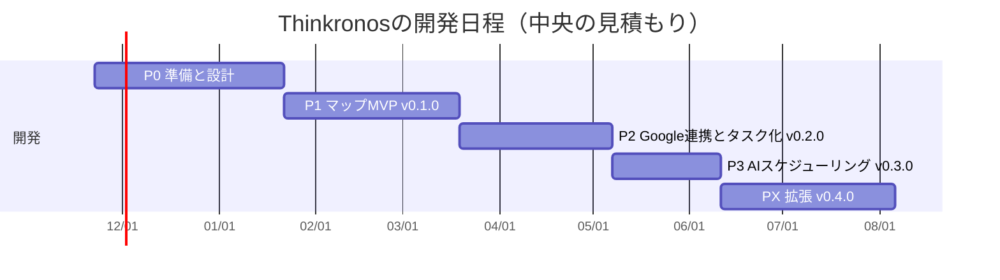
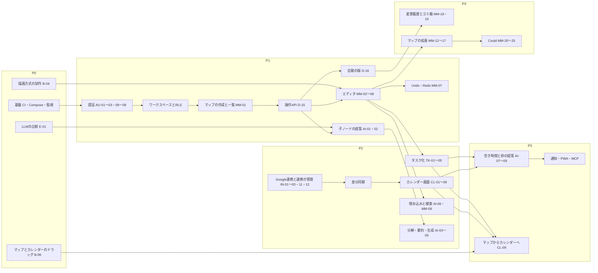

<!-- 正本はこのファイル。企画書（Claude Docs）から 2026-11-23 に移した（K-01）。変更はPRで行う。 -->

# 実装計画

テーマ6（実装計画）の成果物。日程（G-13、G-18）、機能の依存関係、未決の論点を決める時期、P0とP1のIssueの一覧をまとめる。見積もりはClaudeの概算で、実績（G-06）をもとに2週ごとに直す（G-07）。

## 日程

| フェーズ | 中身 | 作業量（中央） | 完了の目標 |
| --- | --- | --- | --- |
| P0 | 準備と設計。リスクの検証を先に行う（G-14） | 約44時間 | 1月下旬 |
| P1 | マップMVP（v0.1.0） | 約63時間 | 3月中旬 |
| P2 | Google連携とタスク化（v0.2.0） | 約64時間 | 5月上旬 |
| P3 | AIスケジューリング（v0.3.0）。ここで成功基準の流れが通る | 約68時間 | 6月中旬 |
| PX | 拡張（v0.4.0）。マップの機能をMindMeisterに近づける | 約102時間 | 8月上旬 |
| P4 | AWS環境への移行（v1.0.0） | ― | 時期は未定 |

前提：開発に使える時間は週5〜15時間で変動する。試験などの予定とは切り離す。全体の幅は、楽観で6月上旬、悲観で11月上旬。

下のIssue一覧で積み上げた見積もりは、P0が約56時間、P1が約89時間で、上の表（P0とP1で約107時間）より約40時間多い。積み上げに寄せると、以降の目標は約3週間ずつ遅れる。12月下旬の最初の振り返りで、実績を見てどちらに寄せるかを決める。

## 機能の依存関係

矢印は「先にできている必要があるもの」を指す。P1の最も長い経路は、基盤→認証→ワークスペースとRLS→マップ→操作API→エディタ→Undo。

## 未決の論点を決める時期

未決の論点を、決める時期ごとに並べる。決定事項一覧の「決める時期」と一致させている（L-51）。

| 決める時期 | 論点 |
| --- | --- |
| テーマ7（テスト計画） | I-01 テスト戦略、I-03 E2Eのシナリオ、I-06 アクセシビリティの検査、B-07 デザインの基準、E-03 AIの評価指標（すべて決定済み） |
| テーマ8（開発開始レビュー） | K-01★ 開発開始後の文書の置き場所、A-04 収益化（すべて決定済み） |
| P0：リスクの検証（12月） | B-04 描画方式、B-06 カレンダーのライブラリ、E-01 ローカルのLLM |
| P0：基盤づくり（12月〜1月） | B-05 UIの基盤、C-12 アーキテクチャの検査、D-07 マイグレーション、D-08 テストデータ、D-18 PostgreSQLの版（15以上）、G-04 コミットのスコープ、I-05 脅威モデリング、K-02 設計図の描き方、G-22 ワーカーの非同期実行方式 |
| P1の開始前（1月下旬） | B-08 キーボード操作、C-11 フロントの状態管理、C-14 メール送信、C-15 パスワードの方針、D-09 バックアップ、E-02 プロンプトの管理 |
| P1の途中 | H-03 CHANGELOG、H-04 コンテナイメージのタグ |
| P2の開始前（3月中旬） | D-10 退会・連携解除時の削除、E-04 AIに渡すデータ、F-01 Googleの権限、F-02 同期の間隔、F-08 連携解除時の作業枠、F-09 Google差分同期の範囲と繰り返し予定 |
| P3の開始前（5月上旬） | E-05 MCPで公開する操作、F-05 通知のタイミング |
| PXの開始前（6月中旬） | D-06 添付ファイルと画像 |
| 保留（条件が整うのを待つ） | C-16 多要素認証、G-09 AIレビューの自動化、G-11 署名付きコミット |

## P0のIssue

画面から登録する（G-16）。順番はリスクの検証が先（G-14）。SizeはS：2時間以内、M：2〜5時間、L：5〜10時間（G-06）。

| 順 | Issue | 内容 | Size | 決める論点 |
| --- | --- | --- | --- | --- |
| 1 | 試作：描画方式の比較 | React Flowと自前のSVGで、自動レイアウト、ドラッグ、500ノードでの動きを比べる。試作のコードは本体に入れない | L（7時間） | B-04 |
| 2 | 試作：マップとカレンダーの間のドラッグ | カレンダーのライブラリの候補で、外部からのドロップを確かめる（R-13） | M（5時間） | B-06 |
| 3 | 試作：ローカルLLMの比較 | Ollamaで、LLM 2〜3種と埋め込み2種を、日本語の子ノード提案とツール呼び出しで比べる（R-02） | M（4時間） | E-01 |
| 4 | 試作の結論をADRに残す | ADR 0012など | S（2時間） | ― |
| 5 | リポジトリの規則 | commitlint、pre-commit、pr-title.yml、branch-policy.yml、必須チェック。共通コマンド（Makefileなど）を用意し、AGENTS.mdにも書く | M（4時間） | G-04 |
| 6 | Docker Compose | API、ワーカー、PostgreSQL（pgvector、pg\_bigm）、Redis、Ollama、ヘルスチェック。pgvectorとpg\_bigmを入れた独自のPostgreSQLイメージ（15以上）を作り、Compose、Testcontainers、CIで共通に使う | M（5時間） | D-18 |
| 7 | CI | ci.yml、security.yml、Dependabot、import-linter | M（4時間） | C-12 |
| 8 | 監視の最小構成 | otel-lgtmと、APIのログ・メトリクス・トレース | M（3時間） | ― |
| 9 | 規約の置き場所 | AGENTS.md（正）、CLAUDE.md（AGENTS.mdを取り込む）、Kiroのsteering（Kiro専用の指示と docs/ への参照）。Kiroの導入時にデータ共有をオプトアウトする | M（4時間。エージェント戦略G-24を含む） | ―（G-10は決定済み） |
| 10 | バックエンドの土台 | FastAPI、SQLAlchemy、Alembic、テストデータの仕組み、Strandsの最小構成のエージェント。Celeryのワーカーで非同期のユースケースを動かす方式を試す（G-22） | M（4時間） | D-07、D-08、G-22 |
| 11 | フロントエンドの土台 | 画面の土台とUIコンポーネントの基盤 | M（3時間） | B-05 |
| 12 | Kiroでマップの仕様 | 設計から始める流れ（Design-First）で、design、requirements、tasksを作る。要件の分析と正しさの確認（性質ベースのテスト）も使い、使ったクレジットを記録する（G-20） | M（4時間） | ― |
| 13 | 設計の記録 | ADR 0001〜0003、0013、0015、0018、脅威モデリング、C4の図 | M（5時間） | I-05、K-02 |
| 14 | 進め方の準備 | Projectsのフィールド（Size、実績時間、Iteration）、マイルストーンPX、P0の振り返りIssue | S（1時間） | ― |
| 15 | 文書を分けて移す | Claudeが用意したMarkdownを、Claude Codeで docs/ にコミットする（要件定義書、実装規約、ADRの下書き）。未決の論点をIssue（ラベル「decision」）に移し、企画書を凍結する。Issue 9と10の後に行う | M（3時間） | K-01 |

合計は約58時間。2026年11月22日に、15件と振り返りIssueをGitHubに登録した。

## P1のIssue

Claude Codeで一括登録する（G-16）。親Issueは機能、サブIssueは1つのPR（G-15）。順番は縦に通す（G-12）。親Issue 3は、Kiroで仕様を作る対象。

| 親Issue | サブIssue（1つのPR） | Size |
| --- | --- | --- |
| 1 縦の骨組み | 1-1 初期のマイグレーション（users、workspaces、workspace\_members、mindmaps、nodes）と、RLSのロールとポリシー（所属するワークスペースの一覧で判定、D-19） | M（5時間） |
| 1 縦の骨組み | 1-2 登録（許可リスト、AU-11）、ログイン、ログアウト、リフレッシュトークン（AU-01、AU-02）。署名鍵にkidを付ける（C-21） | L（6時間） |
| 1 縦の骨組み | 1-3 個人用ワークスペースの自動作成と所属の確認（AU-03） | S（2時間） |
| 1 縦の骨組み | 1-4 マップを作って表示する（ルートだけ）。API、画面、最初のE2E。画面とAPIを同じオリジンで配信する構成にする（C-19） | M（4時間） |
| 2 認証の仕上げ | 2-1 メール送信のポートとMailpit、確認メール（AU-06） | M（4時間） |
| 2 認証の仕上げ | 2-2 パスワード再設定（AU-07） | M（3時間） |
| 2 認証の仕上げ | 2-3 ログインの試行制限（アカウントとIPアドレスの組、段階的な待ち時間。AU-08、C-20） | S（2時間） |
| 2 認証の仕上げ | 2-4 管理用のコマンド（利用者の一覧、停止と解除、許可リストの更新。操作は監査ログに残す、C-27） | M（3時間） |
| 3 マップの編集 | 3-1 操作API（検証、seqの採番、再送の判定、追いつき） | L（7時間） |
| 3 マップの編集 | 3-2 マップの一覧、名前の変更、削除（MM-01） | M（3時間） |
| 3 マップの編集 | 3-3 エディタの描画、自動レイアウト、ズームとパン（MM-05） | L（6時間） |
| 3 マップの編集 | 3-4 ノードの追加、編集、削除（MM-02） | M（4時間） |
| 3 マップの編集 | 3-5 ドラッグでの親の付け替えと並べ替え（MM-03） | M（4時間） |
| 3 マップの編集 | 3-6 折りたたみ（MM-04） | S（2時間） |
| 3 マップの編集 | 3-7 キーボード操作（MM-06） | M（3時間） |
| 3 マップの編集 | 3-8 UndoとRedo（MM-07） | M（4時間） |
| 3 マップの編集 | 3-9 自動の版の保存（D-16） | S（2時間） |
| 3 マップの編集 | 3-10 整合性テスト（スナップショットとその後の操作を再生した結果がnodesと一致すること、D-12） | S（2時間） |
| 4 AIの子ノード提案 | 4-1 LLMのポートとOllamaのアダプター、llm\_callsの記録 | M（4時間） |
| 4 AIの子ノード提案 | 4-2 提案のAPI（SSE）と、採用を操作として追記する処理。ブラウザはfetchで受ける（C-19） | M（4時間） |
| 4 AIの子ノード提案 | 4-3 提案の画面（逐次表示、採用と却下、AI-01、AI-02） | M（4時間） |
| 5 運用とリリース | 5-1 構造化ログ、トレース、REDメトリクスと「API概要」ダッシュボード | M（4時間） |
| 5 運用とリリース | 5-2 E2E（マップ作成→AI提案→採用） | S（2時間） |
| 5 運用とリリース | 5-3 release-prepare.ymlとrelease.yml、v0.1.0のリリース | M（4時間） |
| 5 運用とリリース | 5-4 ローカルでのAIレビューの手順を整える（G-09はP1の終わりに再検討） | S（1時間） |

合計は約89時間。P2以降のIssueは、各フェーズの開始前に同じ形で作る。
